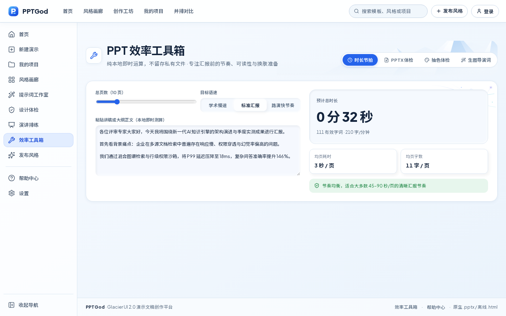
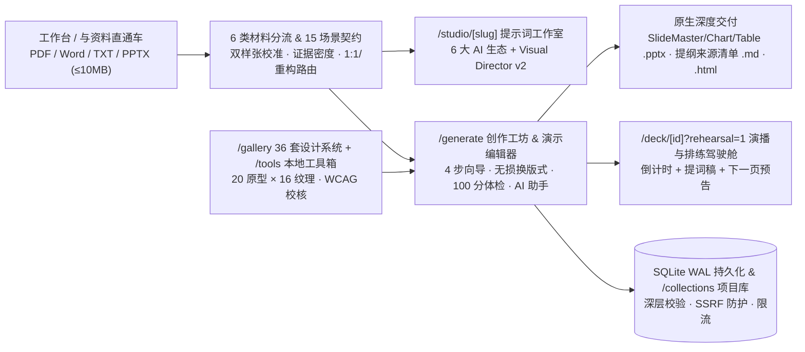

<div align="center">

# PPTGod · Glacier UI 2.0

**复杂留给系统，极致简洁留给用户 · 冰川白玻璃拟态 AI 演示文稿创作平台**

全站 Glacier UI 2.0 冰川白视觉体系 · 资料直通车 6 类材料分流与双样张校准 · 4 步创作工坊 + 全屏沉浸式演示编辑器 · 单页「仅换版式不动字」 · 100 分设计体检 · 真母版/原生图表表格 `.pptx` · 纯本地 `/tools` 效率工具箱


<br />


</div>

---

## 产品定位与核心价值

**PPTGod** 是一个基于 **Next.js 16 (App Router) + React 19 + TypeScript + 100% 纯 Vanilla CSS（Glacier UI 2.0 冰川白玻璃拟态 + 苹果级统一动效语言）+ SQLite (`better-sqlite3`, WAL) + `pptxgenjs` + `mammoth` + `unpdf`** 构建的全栈开源平台，坚持 **「复杂留给系统，不要留给用户」** 与 **「所见即真实能力，零虚假功能」** 原则：

- **Glacier UI 2.0 冰川白全站设计系统**：采用 `70% 实用留白 / 20% 冰川玻璃拟态 / 10% AI 科技蓝点缀` 视觉配比（页面 `#F0F6FC`、冰蓝舞台 `#E7F1FB`、主色 `#2563EB`、深海墨字 `#14243C`），仅对顶栏、浮层与首屏核心面板启用 `@supports (backdrop-filter: blur(12px))`，密集卡片列表使用纯白实底与 `content-visibility: auto` 保障丝滑滚动，严格遵守 `prefers-reduced-motion`。
- **资料直通车 × 6 类材料分流 × 双样张校准**：拖入任意 **PDF / Word (`.docx`) / TXT / Markdown / 旧 `.pptx`**（单文件 `≤ 10 MB`），系统自动判定 6 类材料态（含旧 PPT 自动走 **`1:1 保词换肤`** 路由）、预选证据密度契约与汇报时长，并在 Top 3 推荐风格上提供 **「封面样张 ↔ 代表内容页样张」** 实时切换校准。
- **双模式创作工坊 & 沉浸式演示编辑器（`/generate`）**：引导态提供 4 步垂直 `Stepper`、`60:40` 内容/上传与诚实 `示例预览`、底部风格选择轨、可编辑大纲草案与真实阶段进度条；生成后无缝切换至全屏沉浸式编辑器（自动收起全局侧栏），支持 `大纲 / 幻灯片` 视图、单页 **「仅换版式不动字」**、100 分制 **设计体检** 与一键对比度修复、`/api/polish` **AI 助手**（必须先预览再确认应用，支持 `Ctrl/Cmd+Z` 撤销）及原生 **`.pptx`**（真 `SlideMaster` + 原生图表 `addChart` + 原生表格 `addTable`）、离线 `.html`、Marp 与 `演讲提纲与来源清单.md` 导出。
- **纯本地效率工具箱（`/tools`）与演讲排练驾驶舱（`/deck/[id]?rehearsal=1`）**：纯浏览器本地完成演讲时长节拍测算、旧 PPTX 体检换肤、参考图抽色 + WCAG 投影校核 + `.pptgod.json` 风格包导出、Visual Director v2 生图导演词，并支持已保存文稿直达分屏提词倒计时排练驾驶舱。

---

## Glacier UI 2.0 视觉重构架构与验收总览

按 [Glacier UI 2.0 开发规范](./docs/PPTGod_Glacier_UI_2.0_Development_Spec.md) 与 [PROJECT.md](./PROJECT.md)（功能清单 `F1–F41`、诚实能力边界 `B1–B16`）已完成全站视觉重构与验收：**只升级视觉与组件交互层，100% 保留全部现有 API、SQLite 数据结构、生成/导出引擎与 `#pg-*` 稳定契约，严格剔除无后端支撑的假入口**（零假 Pro 付费卡、零假通知铃铛、零假反馈表单、零假协作/回收站/分组、零伪造 `%` 进度、零假语音评分、零未实现的编辑器形状/动画工具）。

| 阶段 | 内容 | 状态 |
| --- | --- | --- |
| Phase 0 | 路由 / 组件 / CSS / API / E2E 全量审计，输出 `F1–F41` 与 `B1–B16` 清单 | 已完成 |
| Phase 1 · M1a | Design Tokens（`--gl-*`）、冰川品牌 SVG、`AppShell`（64px 顶栏 + 220/64px 可收起侧栏 + 移动抽屉）、通用 UI 组件库、`SlidePreviewFrame` | 已完成 |
| Phase 1 · M1b | 首页工作台 `/`（8:4 AI 创作与上传 / 9:3 同内容 3 风格实时对比与 2×3 推荐 / 4:8 最近项目与 4 快速工具）+ 旧筛选参数服务端重定向 `/gallery` | 已完成 |
| Phase 2 · M2a | 风格画廊 `/gallery`（36 套实库模板、动态计数领域胶囊、URL 双向同步筛选、`StyleDetailDrawer`、智能选词、资料直通车） | 已完成 |
| Phase 2 · M2c | 我的项目 `/collections`（4 张真实统计 KPI 卡、诚实标签栏、搜索/可见性/排序、网格/列表切换、重命名/复制副本/公开私有/导出 PPTX/永久删除确认） | 已完成 |
| Phase 2 · M2b & Phase 3 · M3a | 创作工坊引导态 + 全屏沉浸式演示编辑器 `/generate`（4 步向导、`示例预览`、`OutlineDraftPanel`、全屏编辑顶栏、左侧页树、诚实工具栏、演讲备注 AI 讲稿、`/api/polish` 预览确认 AI 助手、100 分设计体检 + 深浅底色 WCAG 修复）+ `/studio` 重定向 | 已完成 |
| Phase 3 · M3b & Phase 4 | 次级页面 Glacier 化（`/compare` 默认 3 风格同屏对比、`/studio/[slug]`、`/deck/[id]?rehearsal=1`、`/tools?tab=`、`/create`、`/creator/[username]`、可搜索帮助弹窗）+ 5 断点响应式 / 无障碍 / Web Vitals 与 68 项 Glacier E2E 全通 | 已完成 |

### Glacier UI 2.0 全站路由映射

| 路由 | 定位与核心能力 |
| --- | --- |
| `/` | **工作台首页 Dashboard**：AI 生成 / 资料转 PPT / 从模板新建、文档拖拽上传、同一内容 3 风格实时画布对比、推荐风格、真实最近项目与快速工具入口；携带旧画廊查询参数（`q/domain/scenario/style/color/tool/sort`）时服务端自动重定向至 `/gallery` |
| `/gallery` | **风格画廊**：36 套全领域 `VisualSpec` 模板、实时统计 5 大人群分类、多维筛选与 URL 同步、2px 冰川蓝选中态、详情抽屉（12 页型 + 色板 Hex）、30 秒智能选词与资料直通车 |
| `/generate` | **双模式创作工坊 & 演示编辑器**：支持 `?style=`、`?topic=`、`?deck=`、`?handoff=1`、`?intake=1`、`?mode=create\|editor`、`?panel=audit` |
| `/collections` | **我的项目与个人空间**：全部项目 / 最近编辑 / 公开分享 / 我收藏的 / 我发布的 / 我点赞的，完整项目 CRUD 与个人资料编辑 |
| `/compare` | **风格并排对比台**：默认即刻展示 3 套代表风格，支持 12 页型与统一主题同步预览、快速增删替换与参数对比 |
| `/studio` & `/studio/[slug]` | **交互式提示词工作室**：`/studio` 自动跳转精选风格；12 页型胶片条、5 维提示词解剖、6 大 AI 工具编译与离线 `.html` / `.pptgod.json` 导出 |
| `/deck/[id]` | **纯净演播分享与演讲排练驾驶舱**：支持 `?rehearsal=1` 直达分屏提词倒计时排练；私有文稿严格 `404` 零泄露 |
| `/tools` | **纯本地 PPT 效率工具箱**：支持 `?tab=pacing\|pptx-inspect\|palette-wcag\|visual-director` 及登录用户的已保存文稿排练直达入口 |
| `/create` & `/creator/[username]` | **风格创作 / Remix 发布器**（以图抽色 + WCAG 自动校正 + `.pptgod.json` 导入）与 **创作者公开主页** |

### 实测质量与验证结果

- **类型、代码规范与生产构建**：`npx tsc --noEmit --incremental false`、`npm run lint`、`npm run build` 全部通过（**0 errors, 0 warnings**）。
- **5 断点响应式与 Web Vitals 实测**（Chromium `1920 / 1440 / 1024 / 768 / 390px`）：全站核心与次级路由均实现 **`0px` 水平溢出、0 控制台/运行时错误**；实测 8 个路由首屏性能 **LCP `420–1080 ms`**（目标 `≤ 2500 ms`）、**CLS `0.0000–0.0003`**（目标 `≤ 0.1`），键盘 Tab 切换均具备清晰的 `2px solid` `:focus-visible` 焦点环与语义 `<main>` / `<h1>` 地标。
- **Glacier UI 2.0 独立 68 项 E2E 套件（`tests/e2e/glacier_v2/run_glacier_e2e.py --base-url http://127.0.0.1:3010 --tier all --backup-db`）**：
  - 单次全量连续运行 **68/68 PASS（0 failed, 0 errors）**：Tier-1 核心 API **12/12 PASS**、Tier-1 全站 UI 路由 **17/17 PASS**、Tier-2 API 安全与边界 **12/12 PASS**、Tier-2 UI 对抗与恢复 **11/11 PASS**、诚实能力边界 `B1–B16` **16/16 PASS**。
  - **SQLite WAL 数据卫生（`[DB HYGIENE PASS]`）**：`users=3`、`prompts=36`、`prompt_comments=5`、`saved_decks=0`、`[E2E%` 残留 **0 行**、`sessions_delta=0`。

---

## Glacier UI 2.0 核心页面实机截图

[Glacier UI 2.0 完整开发规范](./docs/PPTGod_Glacier_UI_2.0_Development_Spec.md) · [v7 冰川白设计基线规范](./docs/PPTGod_UI_Design_Spec.md)

### 1. 风格画廊（`/gallery`）· 36 套实时 16:9 风格画布与动态计数筛选

<p align="center">
  
</p>

### 2. 创作工坊（`/generate` 引导态）· 4 步向导、资料上传与诚实示例预览

<p align="center">
  
</p>

### 3. 全屏演示编辑器（`/generate` 编辑态）· 仅换版式不动字、设计体检与 AI 助手

<p align="center">
  
</p>

### 4. 我的项目（`/collections`）· 真实 KPI 统计与完整演示文稿管理

<p align="center">
  
</p>

### 5. 提示词工作室（`/studio/[slug]`）、并排对比台（`/compare`）与效率工具箱（`/tools`）

<table>
  <tr>
    <td width="50%"></td>
    <td width="50%"></td>
  </tr>
  <tr>
    <td align="center"><sub>交互式提示词工作室（<code>/studio/[slug]</code>）· 12 页型与 6 大 AI 工具编译</sub></td>
    <td align="center"><sub>风格并排对比台（<code>/compare</code>）· 同主题三栏同步预览</sub></td>
  </tr>
</table>

<p align="center">
  
</p>

---

## 核心引擎能力深度解析

### 1. 资料直通车 · 6 类材料分流 · 场景契约 · 双样张风格校准

在首页 `/` 或 `/generate` 拖入文档（支持 `.pdf / .docx / .pptx / .md / .txt`，单文件 `≤ 10 MB`，亦内置 3 份典型示例资料与纯文本粘贴），系统自动识别 15 类汇报场景、判定 6 类材料态、自动预选证据密度契约（`低认知负担 / 观点与数据均衡 / 严谨证据溯源`；旧 `.pptx` 支持 `1:1 保词换肤` ↔ `重构故事` 切换），并在 Top 3 推荐风格卡片上支持 **「封面样张 ↔ 数据/架构内容样张」** 实时交叉校准。

<p align="center">
  
</p>

### 2. 三端 1:1 渲染引擎 · 无损换版式 · 原生 PowerPoint 深度对象

- **20 种原生版式原型 × 16 种装饰纹理**：所有 36 套设计系统在浏览器 16:9 画布（`SlideCanvas`）、原生 `.pptx` 与离线 `.html` 三端保持 1:1 视觉一致；面向教师授课与科研答辩内置黑板粉笔板书（`chalkboard-class`）、*Nature Methods* Okabe-Ito 色盲安全科研证据流（`scientific-figure`）、国自然 NSFC 蓝红答辩等专业母版。
- **6 大 AI 生态编译与 Visual Director v2**：在 `/studio/[slug]` 支持面向 HTML 交互 PPT、Gamma & Kimi、NotebookLM、AI 整页生图（含 6/12 页批量模式）、Slidev & Marp 与 Python `pptxgenjs` 的结构化编译，按领域注入教学闭环与科研零幻觉红线。
- **单页「仅换版式不动字」与原生深度交付**：在 `/generate` 演示编辑器一键切换 12 种页型时无损保留已审定文案与数据，支持逐页来源状态（`源材料 / 推算 / 模拟假设 / 待核验`）与脚注标注并同步至画布、`演讲提纲与来源清单.md` 及原生 **`.pptx`**（真实 `SlideMaster` 母版、可双击编辑数据的原生图表 `addChart` 与原生表格 `addTable`）。

### 3. 纯净演播分享页与演讲排练提词驾驶舱（`/deck/[id]?rehearsal=1`）

公开保存的文稿可一键生成暗场 16:9 演播分享链接（私有文稿对非作者严格返回 `404` 零泄露）；点击「演讲排练」或按 **`P` 键**即刻进入分屏演讲排练驾驶舱，内置正计时与 **5 分钟路演 / 10 分钟国自然答辩 / 15 分钟公开课 / 30 分钟汇报** 倒计时（等宽数字防抖动、剩余 `< 20%` 琥珀预警、超时红灯）、`A-/A+` 大字号提词稿与下一页 16:9 实时缩略预告（严格只提供真实计时与提词能力，不含虚假 AI 语音评分）。

<p align="center">
  
</p>

---

## 36 套全领域精选风格覆盖矩阵

| 人群领域 | 覆盖场景 | 代表风格与专属设计规范 |
| --- | --- | --- |
| **商业与科技**（11 套） | 产品发布、商业路演、品牌提案、技术分享 | 苹果柔光 Bento、暗夜星环 Keynote、瑞士网格、工业控制论橙黑、北欧静奢、巴黎高定画册、包豪斯几何 |
| **教师与课堂**（5 套） | 课堂教学、教育培训 | 墨绿护眼黑板粉笔板书（`chalkboard-class`）、K12 马卡龙绘本、STEAM 工程方格探究本、公开课青瓷说课、结构化企业内训 |
| **科研与学术**（6 套） | 科研基金、学术答辩 | 国自然 NSFC 蓝红基金答辩、*Nature Methods* Okabe-Ito 色盲安全科研（`scientific-figure`）、顶会组会精读、人文社科档案、临床医药、LaTeX 顶刊 |
| **项目与职场**（9 套） | 项目汇报、咨询汇报、政务党建、个人述职、年度总结 | PMO 红黄绿里程碑看板（`pmo-rag-grid`）、丹宸鎏金政务红金（`civic-redgold`）、Linear 敏捷 OKR、麦肯锡高管洞察、华尔街金融终端、STAR 晋升述职、ESG 绿色精益 |
| **生活与个人**（7 套） | 生活纪实、文化创意、个人述职 | 柯达 35mm 胶片手账游记（`polaroid-zine`）、香槟鼠尾草婚礼纪念、独立书店读书沙龙、牛油果极简生活、宋韵新中式、莫兰迪作品集 |

---

## 系统架构与安全防线



- **深层 `VisualSpec` 强校验**：严格校验所有 CSS 色值、4 色图表元组、20 原型 / 16 纹理枚举、圆角 `[0, 32]` 与 `brandFooter` 纯文本防 XSS。
- **BYOK SSRF 与权限隔离**：拦截云元数据地址、RFC1918/IPv6 内网段与混淆 IP；BYOK `apiKey` 永不落盘 SQLite 且不回显；登录/注册 `429` 限流；私有风格与私有文稿在 SSR、API、OG 图像与 `/sitemap.xml` 全链路严格零泄露。

---

## 本地运行、Docker 部署与全栈测试

### 1. 本地开发运行

```bash
npm install
npm run dev
```

首次启动自动在 `./data/pptgod.db`（WAL 模式）初始化数据库并幂等写入 **36 套全领域精选风格**、3 个种子账号（内置体验账号：`demo@pptgod.studio` / `demo1234`）与 5 条初始实测评价。

### 2. Docker Compose 一键自托管部署

```bash
docker compose up -d --build

# 验证生产探活端点
curl http://localhost:3000/api/health
```

### 3. 生产构建与 Glacier UI 2.0 独立 68 项 E2E 套件

```bash
# 静态类型、React 19 严格 ESLint 与生产构建
npx tsc --noEmit --incremental false
npm run lint
npm run build

# 列出 Glacier UI 2.0 全部 68 项用例（29 项核心功能 + 39 项安全边界与 B1–B16 诚实能力校验）
python3 tests/e2e/glacier_v2/run_glacier_e2e.py --list

# 在独立端口 3010 运行（避免占用 3000 预览端口；端口 3000 被套件主动拒绝）
npx next start --port 3010 --hostname 127.0.0.1
PLAYWRIGHT_BROWSERS_PATH=/opt/ms-playwright python3 tests/e2e/glacier_v2/run_glacier_e2e.py \
  --base-url http://127.0.0.1:3010 --tier all --backup-db
```

### 4. v8 历史回归套件（`tests/e2e/run_e2e.py`）

保留原 v8 基线 109 项端到端黑盒脚本于 `tests/e2e/run_e2e.py`（对应 `main` 分支 v8 布局与历史路由结构）。

---

## 文档索引

| 文档 | 说明 |
| --- | --- |
| [docs/PPTGod_Glacier_UI_2.0_Development_Spec.md](./docs/PPTGod_Glacier_UI_2.0_Development_Spec.md) | Glacier UI 2.0 视觉与开发执行规范（Tokens、组件、页面、响应式、验收清单） |
| [docs/PPTGod_UI_Design_Spec.md](./docs/PPTGod_UI_Design_Spec.md) | v7 冰川白工作台界面设计规范与对照图 |
| [PROJECT.md](./PROJECT.md) | Glacier 2.0 架构、功能清单 `F1–F41`、能力边界 `B1–B16`、阶段与文件归属 |
| [TEST_INFRA.md](./TEST_INFRA.md) | E2E 测试基础设施说明 |
