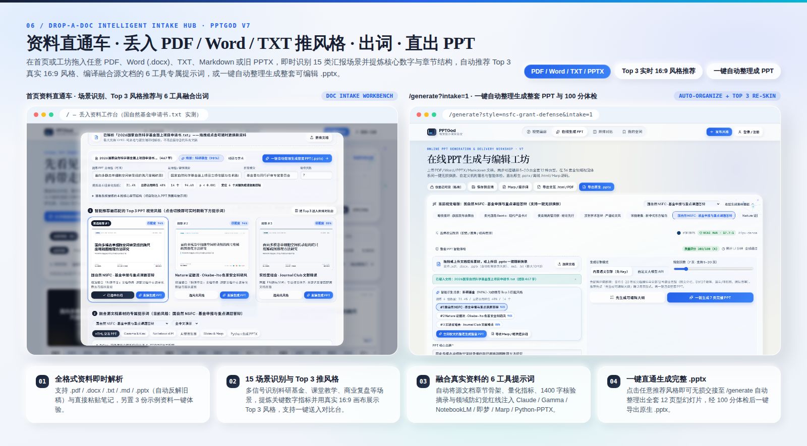
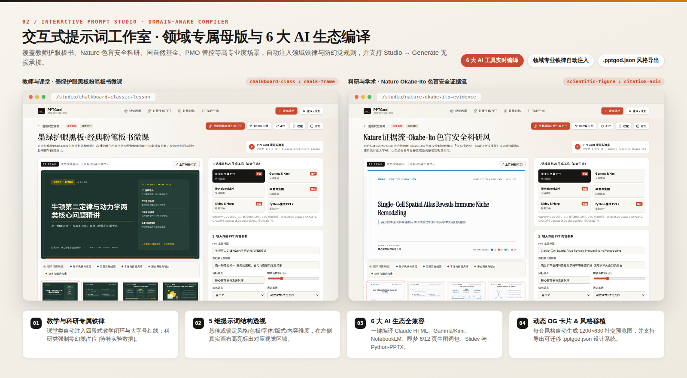
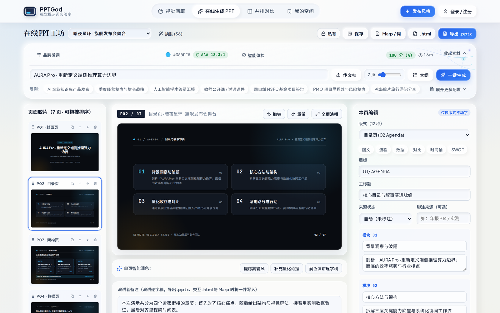
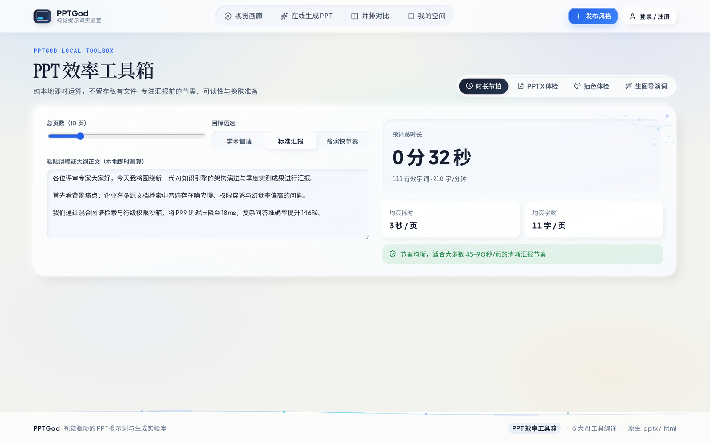
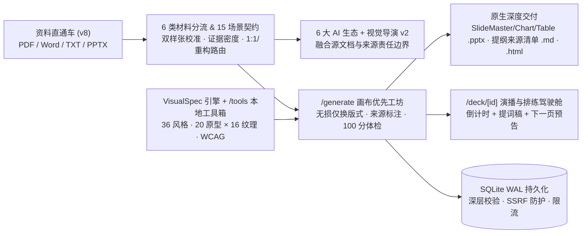

<div align="center">

# PPTGod v8

**复杂留给系统，极致简洁留给用户 · 丢入 PDF / Word / TXT / PPTX，推风格 · 出词 · 直出原生可编辑 PPT**

极致留白玻璃拟态 + 轻拟态画廊 · 证据驱动 6 类材料分流与双样张校准 · 单页「仅换版式不动字」 · 真母版/原生图表表格 `.pptx` · 纯本地 `/tools` 工具箱 · 苹果级统一动效语言


<br />


</div>

---

## 产品定位与核心价值

**PPTGod** 是一个基于 **Next.js 16 (App Router) + React 19 + TypeScript + 100% 纯 Vanilla CSS（玻璃拟态 + 轻拟态 + 统一苹果级动效语言）+ SQLite (`better-sqlite3`, WAL) + `pptxgenjs` + `mammoth` + `unpdf`** 构建的全栈开源平台，坚持 **「复杂留给系统，不要留给用户」** 体验原则：

- **资料直通车 × 6 类材料分流 × 双样张校准（v8）**：拖入任意 **PDF / Word (`.docx`) / TXT / Markdown / 旧 `.pptx`**，系统自动判定 6 类材料态（含旧 PPT 自动走 **`1:1 保词换肤`** 路由）、预选证据密度契约与汇报时长，并在 Top 3 推荐风格上提供 **「封面样张 ↔ 代表内容页样张」** 实时切换校准，彻底告别只看封面盲目批量生成。
- **Figma / Pitch 级极简留白与画布优先（v8）**：首页与 `/generate` 深度视觉减负——二级筛选收纳至单行冷静筛选条、卡片回归纯粹 16:9 艺术画布与 2 行轻量底栏，1440×900 首屏直接完整露出画廊卡片与三栏 PPT 舞台。
- **单页「仅换版式不动字」与原生 PowerPoint 深度对象（v8）**：在 `/generate` 一键切换图文/流程/数据/对比/时间轴/SWOT 版式时**无损保留已审定的标题与业务要点**；逐页标注来源状态（`源材料 / 推算 / 模拟假设 / 待核验`）与脚注并同步至画布、**`演讲提纲与来源/假设清单 (.md)`** 及原生 **`.pptx`**（含真实 **`SlideMaster` 母版**、可双击编辑数据的 **原生图表 `addChart`** 与 **原生表格 `addTable`**）。
- **苹果级统一动效语言 & 纯本地效率工具箱（v8）**：全站收口至单套物理缓动曲线与节奏令牌（仅动画 GPU 合成属性 `transform`/`opacity`，36 卡画廊启用 `content-visibility: auto`，严格遵循 `prefers-reduced-motion`）；页脚静默挂载纯浏览器本地 **[`/tools` PPT 效率工具箱](#7-纯本地-ppt-效率工具箱tools零上传隐私安全)**（时长节拍、PPTX 体检换肤、抽色 WCAG 校核 + `.pptgod.json` 导出、Visual Director v2 生图导演词）。

---

## Glacier UI 2.0 视觉重构（`feat/glacier-ui-2.0` 分支 · 进行中）

按 [Glacier UI 2.0 开发规范](./docs/PPTGod_Glacier_UI_2.0_Development_Spec.md) 对全站做冰川白玻璃拟态重构：**只改视觉与组件层，保留全部现有路由、API、SQLite 数据结构与生成/导出能力，不放置没有后端支撑的假功能**（例如不展示虚假 Pro 付费、协作、语音评分入口）。架构、功能清单（`F1–F41`）与「效果图示意 vs. 真实能力」边界矩阵（`B1–B16`）见 [PROJECT.md](./PROJECT.md)。

| 阶段 | 内容 | 状态 |
| --- | --- | --- |
| Phase 0 | 路由 / 组件 / CSS / API / E2E 全量审计，输出功能边界清单 | 已完成 |
| Phase 1 · M1a | Design Tokens、冰川品牌资产、`AppShell` 全局框架、通用 UI 组件库 | 已完成编码与首轮修复；二轮复验未全部收口 |
| Phase 1 · M1b | 首页 Dashboard `/`（8:4 / 9:3 / 4:8 工作台） | 未开始 |
| Phase 2 | 风格画廊、创作工坊（引导态）、我的项目 | 未开始 |
| Phase 3 | 演示编辑器、对比、提示词工作室、体检、排练及账户/帮助 | 未开始 |
| Phase 4 | 5 断点（390 / 768 / 1024 / 1440 / 1920）响应式、无障碍、性能与全栈回归 | 未开始 |

> [!NOTE]
> 目前已合并到 `main` 的界面仍是 v8；上表中的 Glacier 2.0 改动仅存在于开发分支，尚未合并，也还没有对应的页面截图。

**已落地的设计系统（M1a）**

- **Design Tokens**：[`src/styles/glacier-tokens.css`](./src/styles/glacier-tokens.css)，`--gl-*` 命名空间，纯 Vanilla CSS，不引入 Tailwind 或第二套 UI 框架。核心色值：页面 `#F0F6FC`、冰蓝区 `#E7F1FB`、主色 `#2563EB`、主文字 `#14243C`、分隔线 `#D9E5F1`；主按钮渐变 `135deg #409BFF → #2563EB → #1749D8`。
- **布局与组件样式**：[`glacier-layout.css`](./src/styles/glacier-layout.css)（顶栏 64px、侧栏 220px 可收起、移动抽屉）与 [`glacier-ui.css`](./src/styles/glacier-ui.css)。`backdrop-filter` 仅用于顶栏与浮层，列表与卡片用半透明/实底以保证滚动性能；遵循 `prefers-reduced-motion`。
- **可复用组件**：`src/components/layout/`（`AppShell`、`Topbar`、`Sidebar`、`MobileNavDrawer`、`PageHeader`）、`src/components/ui/`（`GlacierPanel`、`Button`、`IconButton`、`TextInput`/`Textarea`、`Select`、`Tabs`、`FilterChip`、`UploadDropzone`、`Dialog`、`Drawer`、`EmptyState`、`Skeleton`、`Stepper`、`Progress`）、`src/components/presentation/SlidePreviewFrame`（固定 16:9）。
- **品牌资产**：`public/brand/` 下的矢量 Logo 与低对比冰川山脉 SVG，仅作标题区局部点缀，不覆盖文字。
- **已接入**：全局 `layout.tsx`、`AuthModal`、`CompareDock`、`not-found`。

**独立 Glacier E2E 套件**：`tests/e2e/glacier_v2/` 共 68 项用例（`tier1_features.py` 29 项功能 + `tier2_boundaries.py` 39 项边界与「诚实能力」反造假检查），统一入口 `run_glacier_e2e.py`。该套件与下文 109 项 v8 回归测试相互独立，Glacier 页面重构完成前不作为通过率宣称。

---

## 网站核心功能演示效果图

[界面设计规范 · 冰川白工作台（含首页改版对照图）](./docs/PPTGod_UI_Design_Spec.md)

### 1. 资料直通车（v8）· 6 类材料分流 · 场景契约 · 双样张风格校准

在首页统一指令胶囊或 `/generate` 工坊拖入文档（亦内置 3 份典型示例资料与纯文本粘贴），系统自动识别 15 类汇报场景、判定 6 类材料态、自动预选证据密度契约（`低认知负担 / 观点与数据均衡 / 严谨证据溯源`；旧 `.pptx` 支持 `1:1 保词换肤` ↔ `重构故事` 切换），并在 Top 3 推荐风格卡片上支持 **「封面样张 ↔ 数据/架构内容样张」** 实时交叉校准。

<p align="center">
  
</p>

### 2. 极简视觉画廊 · 36 套全领域设计系统与 5 大人群导航

首屏直见 16:9 艺术画布：支持全局输入主题实时刷新全部 36 张风格画布、按 5 大人群领域浏览、单行冷静筛选栏 + 渐进式「筛选」抽屉、首页卡片直切全部 12 种页型，以及 6 目标「30 秒智能选词顾问」。

<p align="center">
  
</p>

### 3. 交互式提示词工作室 · 领域专属母版与 6 大 AI 生态编译

面向教师授课与科研基金等高专业度场景，提供护眼黑板粉笔板书、*Nature Methods* Okabe-Ito 色盲安全科研证据流、国自然 NSFC 蓝红答辩等真实规范母版；编译器自动按领域注入教学闭环铁律、科研零幻觉红线（缺失数据强制占位 `[待补实验数据]`）及 **Visual Director v2** 反塑料感生图边界。

<p align="center">
  
</p>

### 4. 并排风格对比台 · 20 种原生版式 × 16 种纹理三端 1:1 渲染

将 2–3 套心仪风格置于同一画布下，同步切换全部 12 种页型并注入你的真实汇报题目；所有 20 种版式原型与 15 种非空装饰纹理在浏览器画布、原生 `.pptx` 与离线 `.html` 三端保持 1:1 视觉一致。

<p align="center">
  
</p>

### 5. 画布优先在线工坊（`/generate`）· 仅换版式不动字 · 原生母版/图表/表格 `.pptx`

顶栏压缩至单行 52px，将品牌微调与 **100 分制智能体检**收合至单行工具条，16:9 三栏画布直达首屏：右侧属性检查器前置 6 枚一键无损 **「仅换版式不动字」** 快捷芯片与逐页来源状态/脚注编辑（画布、`.pptx` 备注与 `演讲提纲 & 来源核验清单.md` 三端同步），导出 `.pptx` 内置真实 `SlideMaster`、原生可编辑图表（`addChart`）与原生表格（`addTable`）。

<p align="center">
  
</p>

### 6. 纯净演播分享页与演讲排练提词驾驶舱（`/deck/[id]`）

公开保存的文稿可一键生成暗场 16:9 演播分享链接（私有文稿对非作者严格返回 `404` 零泄露）；按 **`P` 键**即刻进入分屏演讲排练驾驶舱，内置正计时与 **5 分钟路演 / 10 分钟国自然答辩 / 15 分钟公开课 / 30 分钟汇报** 倒计时（等宽数字防抖动、剩余 < 20% 琥珀预警、超时红灯）、`A-/A+` 大字号提词稿与下一页 16:9 实时缩略预告。

<p align="center">
  
</p>

### 7. 纯本地 PPT 效率工具箱（`/tools`）· 零上传隐私安全

页脚静默挂载、不打扰主导航，在纯浏览器本地完成四项高频汇报前准备：**① 演讲时长与语速节拍器**、**② 旧 PPTX 体检与备注提取（直达 1:1 换肤）**、**③ 品牌图一键抽色 + WCAG 投影校核 + `.pptgod.json` 风格包导出**、**④ Visual Director v2 视觉导演生图词快编**。

<p align="center">
  
</p>

---

## 36 套全领域精选风格覆盖矩阵

| 人群领域 | 覆盖场景 | 代表风格与专属设计规范 |
| --- | --- | --- |
| **商业与科技**（11 套） | 产品发布、商业路演、品牌提案、技术分享 | 苹果柔光 Bento、暗夜星环 Keynote、瑞士网格、工业控制论橙黑、北欧静奢、巴黎高定画册、包豪斯几何 |
| **教师与课堂**（5 套） | 课堂教学、教育培训 | 墨绿护眼黑板粉笔板书（`chalkboard-class`）、K12 马卡龙绘本、STEAM 工程方格探究本、公开课青瓷说课、结构化企业内训 |
| **科研与学术**（6 套） | 科研基金、学术答辩 | 国自然 NSFC 蓝红基金答辩、*Nature Methods* Okabe-Ito 色盲安全科研（`scientific-figure`）、顶会组会精读、人文社科档案、临床医药、LaTeX 顶刊 |
| **项目与职场**（9 套） | 项目汇报、咨询汇报、政务党建、个人述职、年度总结 | PMO 红黄绿里程碑看板（`pmo-rag-grid`）、丹宸鎏金政务红金（`civic-redgold`）、Linear 敏捷 OKR、麦肯锡高管洞察、华尔街金融终端、STAR 晋升述职、ESG 绿色精益 |
| **生活与个人**（7 套） | 生活纪实、文化创意、个人述职 | 柯达 35mm 胶片手账游记（`polaroid-zine`）、香槟鼠尾草婚礼纪念、独立书店读书沙龙、牛油果极简生活、宋韵新中式、莫兰迪作品集 |

---

## 系统架构与安全防线



- **深层 `VisualSpec` 强校验**：严格校验所有 CSS 色值、4 色图表元组、20 原型 / 16 纹理枚举、圆角 `[0, 32]` 与 `brandFooter` 纯文本防 XSS。
- **BYOK SSRF 与权限隔离**：拦截云元数据地址、RFC1918/IPv6 内网段与混淆 IP；登录/注册 `429` 限流；私有风格与私有文稿在 SSR、API、OG 图像与 `/sitemap.xml` 全链路严格零泄露。

---

## 本地运行、Docker 部署与全栈测试

### 1. 本地开发运行

```bash
npm install
npm run dev
```

首次启动自动在 `./data/pptgod.db`（WAL 模式）初始化数据库并幂等写入 **36 套全领域精选风格**、3 个种子账号（内置体验账号：`demo@pptgod.studio` / `demo1234`）与 5 条初始实测评价。

### 2. Docker Compose 一键自托管部署

```bash
docker compose up -d --build

# 验证生产探活端点
curl http://localhost:3000/api/health
```

### 3. 生产构建与 109 条全栈黑盒端到端测试

```bash
# 静态类型、React 19 严格 ESLint 与生产构建
npx tsc --noEmit --incremental false
npm run lint
npm run build
npx next start --port 3000

# 运行覆盖 Tiers 1–10 的 109 条全栈端到端黑盒测试（含动效帧率/CLS/无障碍与 SQLite WAL 审计）
PLAYWRIGHT_BROWSERS_PATH=/opt/ms-playwright python3 tests/e2e/run_e2e.py \
  --base-url http://localhost:3000 --tier all --backup-db
```

### 4. Glacier UI 2.0 独立 E2E 套件（开发分支）

```bash
# 列出全部 68 项用例
python3 tests/e2e/glacier_v2/run_glacier_e2e.py --list

# 在独立端口运行，避免占用线上预览端口（3000 端口被套件拒绝）
npx next start --port 3010 --hostname 127.0.0.1
PLAYWRIGHT_BROWSERS_PATH=/opt/ms-playwright python3 tests/e2e/glacier_v2/run_glacier_e2e.py \
  --base-url http://127.0.0.1:3010 --tier all --backup-db
```

---

## 文档索引

| 文档 | 说明 |
| --- | --- |
| [docs/PPTGod_Glacier_UI_2.0_Development_Spec.md](./docs/PPTGod_Glacier_UI_2.0_Development_Spec.md) | Glacier UI 2.0 视觉与开发执行规范（Tokens、组件、页面、响应式、验收清单） |
| [docs/PPTGod_UI_Design_Spec.md](./docs/PPTGod_UI_Design_Spec.md) | v7 冰川白工作台界面设计规范与对照图 |
| [PROJECT.md](./PROJECT.md) | Glacier 2.0 架构、功能清单 `F1–F41`、能力边界 `B1–B16`、阶段与文件归属 |
| [TEST_INFRA.md](./TEST_INFRA.md) | E2E 测试基础设施说明 |
