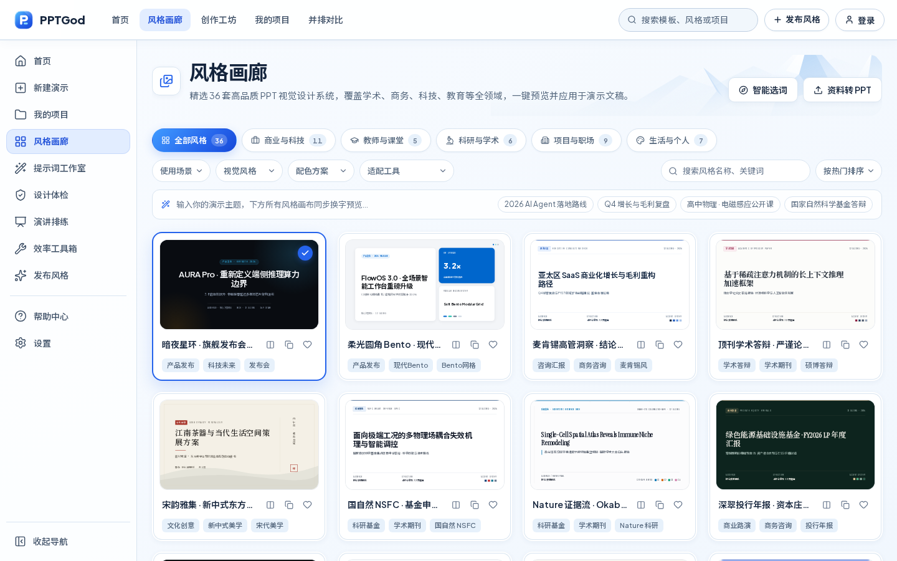
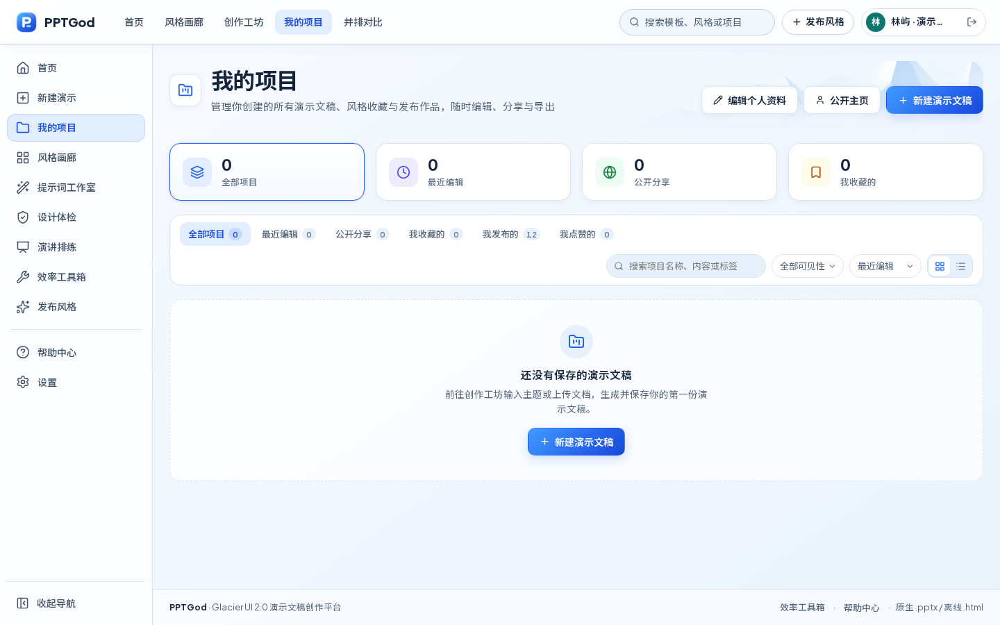
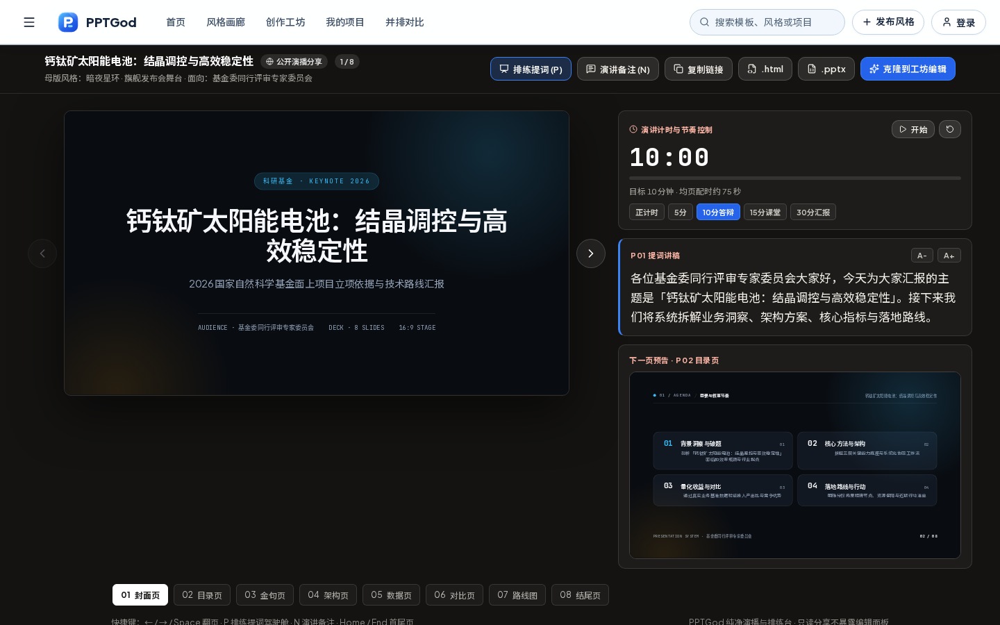
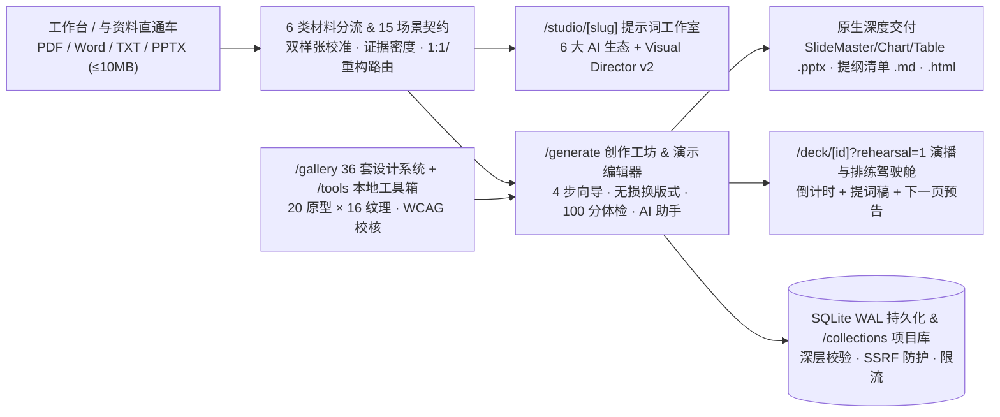

<div align="center">

# PPTGod · Glacier UI 2.0

**复杂留给系统，简洁留给用户 · 冰川白玻璃拟态 AI 演示文稿创作平台**

丢入 PDF / Word / PPTX / Markdown，自动推风格、编提示词、生成可编辑幻灯片，直出原生 `.pptx` 与离线 `.html`


<br />


</div>

---

## 产品定位与设计原则

**PPTGod** 基于 **Next.js 16 (App Router) + React 19 + TypeScript + 100% 纯 Vanilla CSS + SQLite (`better-sqlite3`, WAL) + `pptxgenjs` + `mammoth` + `unpdf`** 构建，全站采用 **Glacier UI 2.0 冰川白视觉语言**，遵循两条核心工程原则：**「复杂留给系统，简洁留给用户」** 与 **「所见即真实能力，零虚假功能」**。

| 核心维度 | 工程落地与体验标准 |
| --- | --- |
| **Glacier UI 2.0 冰川白系统** | `70%` 实用留白 / `20%` 冰川玻璃拟态 / `10%` AI 科技蓝点缀（`#F0F6FC` 页面底、`#E7F1FB` 冰蓝舞台、`#2563EB` 主色、`#14243C` 深海墨字）；`@supports (backdrop-filter: blur(12px))` 仅用于顶栏、浮层与首屏核心卡，卡片网格采用纯白实底 + `content-visibility: auto`，全面支持 `prefers-reduced-motion` |
| **端到端演示创作工作流** | 从 `/` 首页输入主题或拖入资料 → `/gallery` 36 套实时 16:9 画布选风格 → `/generate` 4 步向导规划大纲 → 全屏沉浸式编辑器逐页精修与 AI 润色 → 导出原生 `.pptx` / 离线 `.html` / Marp / 演讲提纲 `.md`，或直达 `/deck/[id]?rehearsal=1` 分屏提词排练 |
| **纯本地工具与隐私隔离** | `/tools` 工具箱纯浏览器本地运行（时长节拍、PPTX 体检换肤、抽色 WCAG 校核、Visual Director v2 生图导演词）；BYOK 自定义大模型 Key 仅当次请求透传、永不落盘；私有风格与私有文稿全链路 `404` 严格隔离 |
| **诚实能力边界（`B1–B16`）** | 严格剔除无后端支撑的示意性伪造控件：零假 Pro 付费卡、零假通知铃铛、零假反馈表单、零假协作/回收站/分组、零伪造 `%` 进度条、零假语音评分、零未实现的编辑器自由形状/动画工具 |

---

## Glacier UI 2.0 核心界面实机总览

<table>
  <tr>
    <td width="50%"></td>
    <td width="50%"></td>
  </tr>
  <tr>
    <td align="center"><sub><b>风格画廊（<code>/gallery</code>）</b>· 36 套实时 16:9 风格画布、动态计数分类与详情抽屉</sub></td>
    <td align="center"><sub><b>创作工坊（<code>/generate</code> 引导态）</b>· 4 步垂直向导、资料上传与诚实示例预览</sub></td>
  </tr>
  <tr>
    <td width="50%"></td>
    <td width="50%"></td>
  </tr>
  <tr>
    <td align="center"><sub><b>演示编辑器（<code>/generate</code> 编辑态）</b>· 全屏沉浸舞台、单页换版式与 AI 润色预览</sub></td>
    <td align="center"><sub><b>我的项目（<code>/collections</code>）</b>· 真实 KPI 统计、网格/列表切换与完整项目 CRUD</sub></td>
  </tr>
  <tr>
    <td width="50%"></td>
    <td width="50%"></td>
  </tr>
  <tr>
    <td align="center"><sub><b>提示词工作室（<code>/studio/[slug]</code>）</b>· 12 页型胶片条、5 维解剖与 6 大 AI 生态编译</sub></td>
    <td align="center"><sub><b>风格并排对比（<code>/compare</code>）</b>· 默认三栏同主题同步比对 12 种页型</sub></td>
  </tr>
</table>

<p align="center">
  
  <br />
  <sub><b>纯本地效率工具箱（<code>/tools</code>）</b>· 演讲时长节拍 · PPTX 体检换肤 · 以图抽色与 WCAG 校核 · Visual Director v2 导演词</sub>
</p>

---

## 核心引擎能力深度解析

### 1. 资料直通车引擎 · 6 类材料分流 × 证据契约 × 双样张校准

拖入任意 `.pdf` / `.docx` / `.pptx` / `.md` / `.txt`（单文件 `≤ 10 MB`，亦支持纯文本粘贴与 **4 份内置示例**：*Attention Is All You Need* / *DeepSeek-R1* 论文精读、人教版高中物理《牛顿第二定律》、统编版初中语文《岳阳楼记》），系统在浏览器与服务端协同完成从原稿解析到风格校准的 4 步自动路由：

| 引擎环节 | 自动化决策能力 |
| --- | --- |
| **① 多格式解析与边界守卫** | 基于 `unpdf` / `mammoth` / `jszip` 提取正文、章节与旧 PPT 备注；自动识别扫描版图片 PDF 并温和预警，不丢弃草稿 |
| **② 6 类材料态 × 15 场景识别** | 自动判定论文/基金、数据报表、商业汇报、教学课件、产品方案或旧 `.pptx`（旧 PPT 默认提供 **`1:1 保词换肤`** ↔ `重构故事` 路由） |
| **③ 证据密度契约与指标抽取** | 自动抽取核心百分比、延迟、样本量与显著性指标，预选 `低认知负担 / 观点与数据均衡 / 严谨证据溯源` 表达契约并估算汇报时长 |
| **④ Top 3 双样张交叉校准** | 推荐风格卡片支持实时切换 **「封面样张 ↔ 数据/内容样张」**，告别只看封面盲目批量生成，一键带入工坊或导出融合提示词 |

<p align="center">
  
</p>

---

### 2. 三端 1:1 渲染引擎 · 100 分智能体检 × 原生深度 `.pptx`

所有 36 套设计系统由统一的确定性 `VisualSpec` 驱动，覆盖 **20 种原生版式原型 × 16 种装饰纹理 × 12 种商业/学术页型**，并在编辑器内置 **100 分制设计体检（`deckLinter`）** 与 **预览确认型 AI 助手（`/api/polish`）**：

| 交付终端 | 核心引擎能力与一致性保障 |
| --- | --- |
| **浏览器 16:9 实时舞台** | `SlideCanvas` 零偏移渲染全部 12 种页型；右侧属性栏支持单页 **「仅换版式不动字」** 无损重排、逐页标注来源状态（`源材料 / 推算 / 模拟假设 / 待核验`）与脚注；`Ctrl/Cmd+Z` 完整撤销栈 |
| **100 分制设计体检与 AI 润色** | 实时评估投影对比度（WCAG 2.1 AA/AAA，支持深浅底色一键自动校正）、单页文字密度、叙事起承转合与讲稿覆盖率；AI 助手支持 `高管精炼 / 补充量化论据 / 优化演讲稿`，必须先预览 diff 再确认应用 |
| **原生可编辑 `.pptx` 与多格式交付** | 基于 `pptxgenjs` 写入真实 **`SlideMaster` 母版**、可双击修改源数据的 **原生图表 `addChart`**、**原生表格 `addTable`** 及演讲者备注；同步支持零外链单文件 **离线 `.html`**、`Marp` Markdown 与 **`演讲提纲与来源核验清单.md`** |

<p align="center">
  
</p>

---

### 3. 纯净演播分享与演讲排练驾驶舱（`/deck/[id]?rehearsal=1`）

公开发布的演示文稿自动生成独立 16:9 暗场演播分享页（私有文稿对非作者严格返回 `404` 零泄露）。点击「排练提词」或按 **`P` 键** 即刻切入分屏排练模式：

- **多场景倒计时节奏控制**：内置正计时与 **5 分钟路演 / 10 分钟国自然答辩 / 15 分钟公开课 / 30 分钟汇报** 预设，采用等宽数字（`tabular-nums`）防抖动，剩余 `< 20%` 琥珀预警、超时红灯提醒。
- **沉浸提词与下一页预告**：当前页逐字演讲稿支持 `A- / A+` 实时缩放字号；右下角同步展示下一页 16:9 完整版式预览，点击或键盘 `← / → / Space` 平滑翻页。
- **诚实能力定位**：聚焦真实计时、提词与翻页排练，不伪造麦克风录音或虚假 AI 语音评分；支持一键导出 `.html` / `.pptx` 或克隆至工坊继续二次编辑。

<p align="center">
  
</p>

---

## 全站路由映射与 36 套精选风格矩阵

### 全站路由映射

| 路由 | 页面与核心能力 |
| --- | --- |
| `/` | **工作台首页 Dashboard**：AI 生成 / 资料转 PPT / 从模板新建、文档拖拽上传、同内容 3 风格实时对比、推荐风格、真实最近项目与快速工具；携带旧画廊查询参数时服务端自动重定向至 `/gallery` |
| `/gallery` | **风格画廊**：36 套全领域 `VisualSpec` 模板、实时统计 5 大人群分类、多维筛选与 URL 同步、详情抽屉（12 页型 + Hex 色板）、30 秒智能选词与资料直通车 |
| `/generate` | **创作工坊 & 演示编辑器**：支持 `?style=`、`?topic=`、`?deck=`、`?handoff=1`、`?intake=1`、`?mode=create\|editor`、`?panel=audit` |
| `/collections` | **我的项目与个人空间**：全部项目 / 最近编辑 / 公开分享 / 我收藏的 / 我发布的 / 我点赞的，完整项目 CRUD 与个人资料编辑 |
| `/compare` | **风格并排对比台**：默认即刻展示 3 套代表风格，支持 12 页型与统一主题同步预览、快速增删替换与规范比对 |
| `/studio` & `/studio/[slug]` | **交互式提示词工作室**：`/studio` 自动跳转精选风格；12 页型胶片条、5 维提示词解剖、6 大 AI 生态编译与 `.html` / `.pptgod.json` 导出 |
| `/deck/[id]` | **纯净演播分享与演讲排练驾驶舱**：支持 `?rehearsal=1` 自动打开排练面板；私有文稿严格 `404` 零泄露 |
| `/tools` | **纯本地 PPT 效率工具箱**：支持 `?tab=pacing\|pptx-inspect\|palette-wcag\|visual-director` 及已保存文稿排练直达 |
| `/create` & `/creator/[username]` | **风格创作 / Remix 发布器**（以图抽色 + WCAG 自动校正 + `.pptgod.json` 导入）与 **创作者公开主页** |

### 36 套全领域精选风格覆盖矩阵

| 人群领域 | 覆盖场景 | 代表风格与专属设计规范 |
| --- | --- | --- |
| **商业与科技**（11 套） | 产品发布、商业路演、品牌提案、技术分享 | 柔光圆角 Bento、暗夜星环 Keynote、瑞士网格、机能工业黑橙、北欧静奢、巴黎高定画册、包豪斯几何 |
| **教师与课堂**（5 套） | 课堂教学、教育培训 | 墨绿护眼黑板粉笔板书（`chalkboard-class`）、K12 马卡龙绘本、STEAM 工程方格探究本、公开课青瓷说课、结构化企业内训 |
| **科研与学术**（6 套） | 科研基金、学术答辩 | 国自然 NSFC 蓝红基金答辩、*Nature Methods* Okabe-Ito 色盲安全科研（`scientific-figure`）、顶会组会精读、人文社科档案、临床医药、LaTeX 顶刊 |
| **项目与职场**（9 套） | 项目汇报、咨询汇报、政务党建、个人述职、年度总结 | PMO 红黄绿里程碑看板（`pmo-rag-grid`）、丹宸鎏金政务红金（`civic-redgold`）、Linear 敏捷 OKR、麦肯锡高管洞察、华尔街金融终端、STAR 晋升述职、ESG 绿色精益 |
| **生活与个人**（7 套） | 生活纪实、文化创意、个人述职 | 柯达 35mm 胶片手账游记（`polaroid-zine`）、香槟鼠尾草婚礼纪念、独立书店读书沙龙、牛油果极简生活、宋韵新中式、莫兰迪作品集 |

---

## 系统架构、安全防线与项目结构



- **深层 `VisualSpec` 强校验**：严格校验所有 CSS 色值、4 色图表元组、20 原型 / 16 纹理枚举、圆角 `[0, 32]` 与 `brandFooter` 纯文本防 XSS。
- **BYOK SSRF 与隐私隔离**：拦截云元数据地址、RFC1918/IPv6 内网段与混淆 IP；BYOK `apiKey` 永不落盘 SQLite 且不回显；登录/注册 `429` 限流；私有风格与私有文稿在 SSR、API、OG 图像与 `/sitemap.xml` 全链路严格零泄露。

<details>
<summary><b>展开查看项目目录结构</b></summary>

```text
PPTGod/
├── src/
│   ├── app/                    # Next.js 16 App Router 页面与 22 个后端 API 路由
│   ├── components/
│   │   ├── layout/             # Glacier UI 2.0 全局框架（AppShell / Topbar / Sidebar / MobileNavDrawer / PageHeader）
│   │   ├── ui/                 # 通用无框架 UI 组件库（Button / Dialog / Drawer / Input / Select / Tabs / Stepper / UploadDropzone 等）
│   │   ├── dashboard/          # 首页工作台组件（CreatePanel / StyleShowcase / WorkspacePanels）
│   │   ├── presentation/       # 演示与卡片展示组件（SlidePreviewFrame / StyleCard / StyleDetailDrawer / ProjectCard）
│   │   ├── generate/           # 创作工坊向导、全屏演示编辑器、设计体检、大纲草案与配图管理
│   │   └── slide-canvas/       # 16:9 SlideCanvas 渲染核心（20 原型 × 16 纹理 × 12 页型）
│   ├── context/                # AppContext（认证/对比/全局状态）与 LayoutContext（侧栏/全屏编辑/弹窗）
│   ├── lib/                    # SQLite WAL、文档解析、大纲与生成、设计体检、WCAG 校核、PPTX/HTML/Marp 导出、SSRF 防护
│   ├── styles/                 # 100% 纯 Vanilla CSS（glacier-tokens / glacier-layout / glacier-ui 与分模块样式）
│   └── types/                  # 领域与 VisualSpec 强类型定义
├── public/brand/               # Glacier 冰川矢量 Logo 与低对比雪峰装饰 SVG
├── docs/                       # 开发规范、架构文档、测试设施说明与 Glacier UI 2.0 实机截图
├── tests/e2e/glacier_v2/       # 独立 68 项全栈黑盒 Playwright E2E 套件（含 WAL 卫生与 B1–B16 反造假验证）
├── Dockerfile & docker-compose.yml
└── README.md
```

</details>

---

## 本地运行、Docker 部署与质量验证

### 1. 本地开发运行

```bash
npm install
npm run dev
```

首次启动自动在 `./data/pptgod.db`（WAL 模式）初始化数据库并幂等写入 **36 套全领域精选风格**、3 个种子账号（体验账号：`demo@pptgod.studio` / `demo1234`）与 5 条初始实测评价。

### 2. Docker Compose 一键自托管部署

```bash
docker compose up -d --build

# 验证生产探活端点
curl http://localhost:3000/api/health
```

### 3. 生产构建与 Glacier UI 2.0 独立 79 项 4-Tier E2E 套件

```bash
# 静态类型检查、React 19 严格 ESLint 与生产构建
npm run typecheck
npm run lint
npm run build

# 列出 Glacier UI 2.0 全部 79 项用例（Tiers 1–4）
npm run test:e2e:list

# 在独立端口 3010 运行全量黑盒端到端验证（自动执行 WAL 安全快照与数据卫生审计）
./node_modules/.bin/next start --port 3010 --hostname 127.0.0.1
PLAYWRIGHT_BROWSERS_PATH=/opt/ms-playwright npm run test:e2e
```

### 实测验收报告

| 检查项 | 实测结果 |
| --- | --- |
| **TypeScript / ESLint / Next Build** | `0 errors, 0 warnings` |
| **5 断点响应式（`1920 / 1440 / 1024 / 768 / 390px`）** | 全站 9 大核心与次级路由（45 组合） **`0px` 水平溢出**、**`0` 控制台/运行时错误**，`390px` 移动端编辑器胶片条防截断与可折叠检查器实测通过 |
| **Web Vitals & 键盘无障碍（8 路由实测）** | **LCP `420–1080 ms`**（目标 `≤ 2500 ms`）、**CLS `0.0000–0.0003`**（目标 `≤ 0.1`），完整 `:focus-visible` 焦点环与 `<main>`/`<h1>` 地标 |
| **Glacier E2E 79 项 4-Tier 全量套件（单次连续运行）** | **79/79 PASS**（Tier-1 API `12/12` · Tier-1 UI `17/17` · Tier-2 API `12/12` · Tier-2 UI `11/11` · 诚实边界 `B1–B16` `16/16` · Tier-3 交互与本地 BYOK `4/4` · Tier-4 5断点/视觉一致性 `7/7`） |
| **SQLite WAL 数据卫生（`--backup-db`）** | **`[DB HYGIENE PASS]`**（`users=3`、`prompts=36`、`prompt_comments=5`、`saved_decks=0`、`[E2E%` 残留 `0`、`sessions_delta=0`） |

---

## 文档索引

| 文档 | 说明 |
| --- | --- |
| [docs/PPTGod_Glacier_UI_2.0_Development_Spec.md](./docs/PPTGod_Glacier_UI_2.0_Development_Spec.md) | Glacier UI 2.0 视觉与开发执行规范（Tokens、组件、页面、响应式、验收清单） |
| [docs/PROJECT.md](./docs/PROJECT.md) | Glacier UI 2.0 架构、功能清单 `F1–F41`、能力边界 `B1–B16` 与里程碑记录 |
| [docs/TEST_INFRA.md](./docs/TEST_INFRA.md) | Glacier UI 2.0 独立 79 项 4-Tier E2E 测试基础设施说明 |
| [docs/PPTGod_UI_Design_Spec.md](./docs/PPTGod_UI_Design_Spec.md) | 冰川白工作台早期设计规范与首页改版对照图 |
