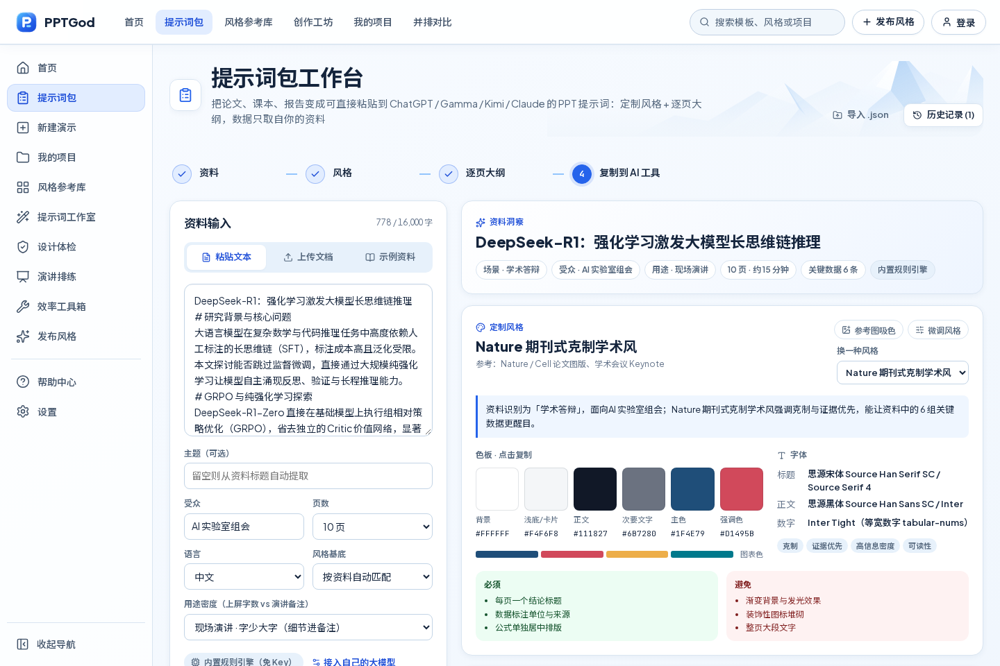
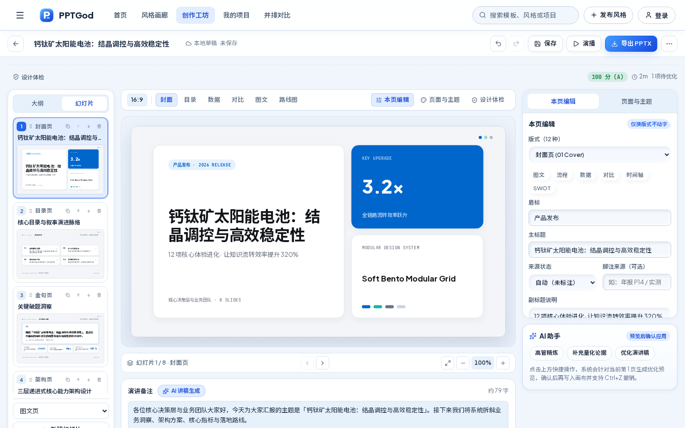
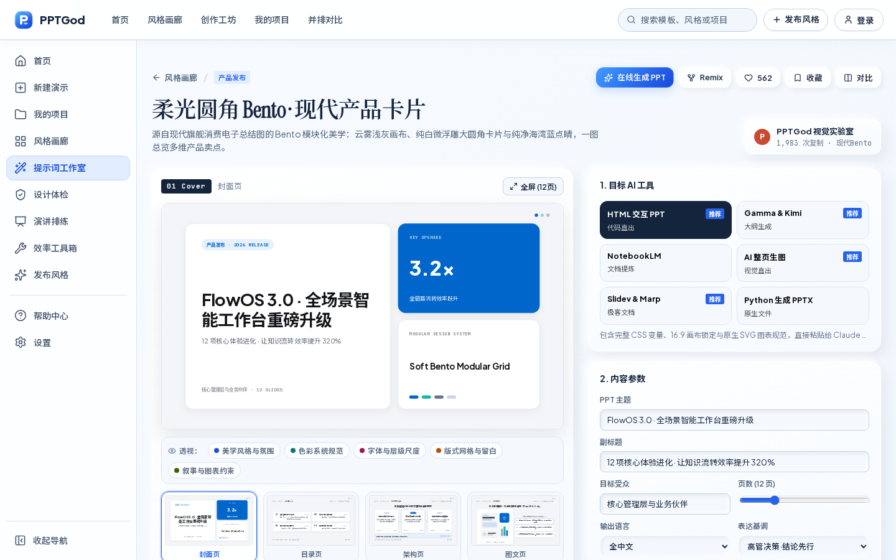
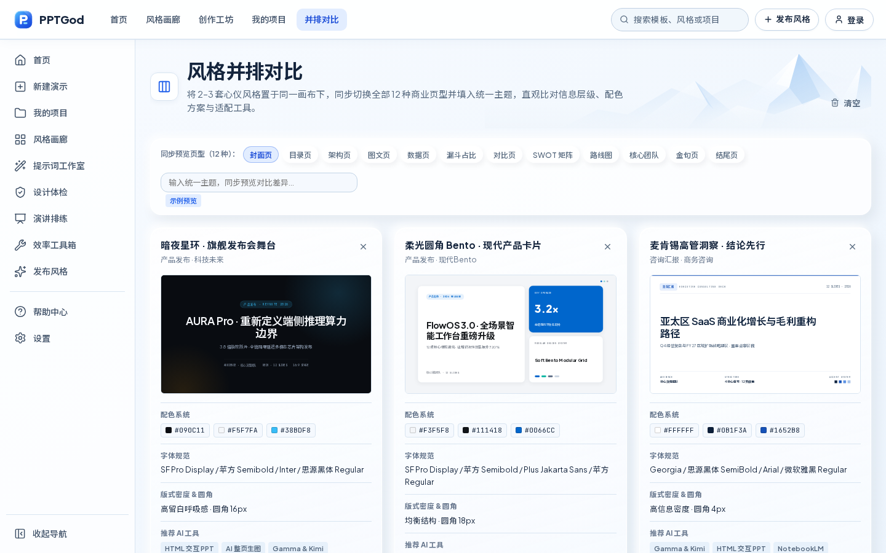
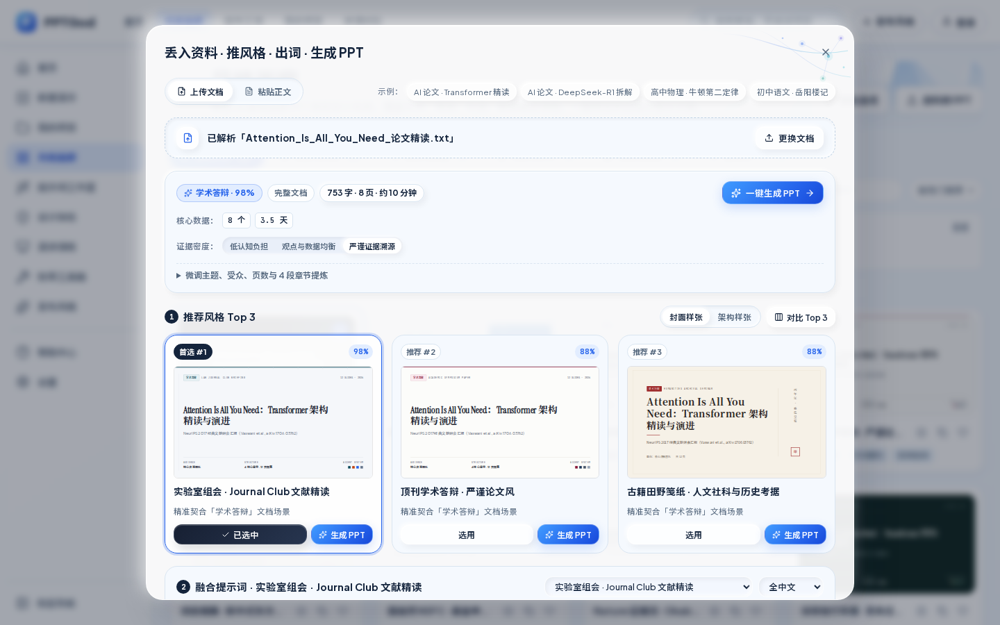
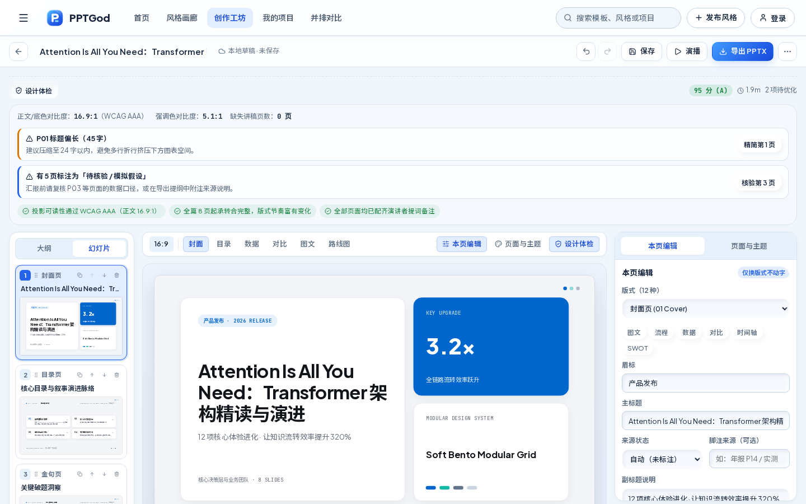
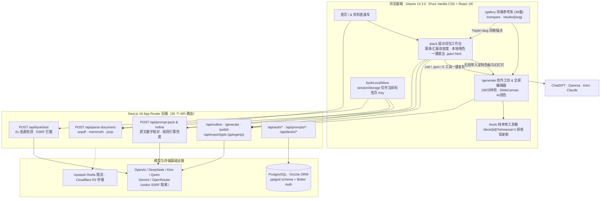

<div align="center">

# PPTGod · Glacier UI 2.0

**把论文、课本与报告，变成「能直接出好成品」的定制 PPT 提示词包与原生演示文稿**

丢入原始资料，一键提炼 **定制视觉风格规范（HEX 色板 / 字体 / 版式语法）+ 有原文依据的逐页大纲**，直接复制到 ChatGPT / Gamma / Kimi / Claude 生成成品；也可在站内编辑并导出原生可编辑 `.pptx` 与零外链离线 `.html`


[项目介绍](#项目介绍) · [产品功能](#产品功能全景) · [核心引擎](#核心引擎深度解析) · [技术路线与架构](#技术路线与系统架构) · [开发进程与路线图](#开发进程与路线图) · [本地运行与部署](#本地运行测试与上线)

<br />


</div>

---

## 项目介绍

### 为什么做 PPTGod？

用 AI 做 PPT 时，最常见的三种挫败感是：**视觉廉价**（固定模板千篇一律、配色刺眼）、**版式单一**（从头到尾都是「标题 + 项目符号」）、**内容空洞**（编造通用套话、和原始资料脱节）。因此，许多高效用户的真实工作流其实是：**先把论文、教案或报告喂给 ChatGPT / Claude / Gamma，让它定制风格提示词，再按逐页结构生成 PPT。**

**PPTGod** 正是围绕这一真实工作流打造的开源 AI 演示文稿创作平台：

- **以「资料 → 提示词包（`/pack`）」为核心**：上传或粘贴原始资料，自动提炼贴合主题气质的定制视觉规范与多样化逐页大纲，按 ChatGPT、Gamma、Kimi PPT、Claude 及通用 Markdown 分别格式化，一键粘贴即用；每一条数字事实均核对原文，杜绝幻觉凑页。
- **以「风格参考库 + 站内原生 `.pptx` 工坊」为闭环**：内置 36 套实时 16:9 渲染的视觉设计系统，既可作为 `/pack` 的风格参考锚点，也可直接在站内全屏编辑、做 100 分制设计体检、导出含原生母版/图表/表格的 `.pptx` 与独立 `.html`，并在暗场排练驾驶舱完成提词演练。
- **两条硬性工程原则**：
  1. **复杂留给系统，简洁留给用户**：全站采用 **Glacier UI 2.0 冰川白玻璃拟态语言**（`70%` 实用留白 / `20%` 冰川玻璃拟态 / `10%` 科技蓝点缀），100% 纯 Vanilla CSS，支持 5 断点响应式与 `prefers-reduced-motion`。
  2. **所见即真实能力，零虚假功能（`B1–B16`）**：绝不堆砌无后端支撑的假付费卡、假通知红点、假进度百分比、假语音评分或未实现的编辑器工具；大模型不可用时诚实披露原因并降级至内置规则引擎。

### 适用人群与高频场景

| 使用场景 | 典型资料输入 | PPTGod 交付产物 |
| --- | --- | --- |
| **科研文献与学术答辩** | AI/理工科论文 PDF、开题报告、实验记录 | Nature 期刊式克制学术风提示词包、含实验数据图表/大数字页的大纲、10 分钟答辩排练计时 |
| **中学/高校课堂公开课** | 物理/语文/化学教材章节、公开课教案 | 新课标教材插画风 / 新中式东方美学风提示词包、情境导入 + 例题分步流程版式 |
| **商业汇报与季度复盘** | 经营复盘报告、SaaS 指标表、项目总结 | 麦肯锡咨询风 / 深色路演风提示词包、核心指标大数字与对比页、原生可编辑 `.pptx` |
| **存量 PPT 体检与换肤** | 旧版 `.pptx`、喜欢的参考图/海报截图 | 参考图本地吸色 + WCAG 对比度校正、100 分设计体检、`1:1 保词换肤` 导出 |

---

## 产品功能全景

<table>
  <tr>
    <td width="50%"></td>
    <td width="50%"></td>
  </tr>
  <tr>
    <td align="center"><sub><b>提示词包工作台（<code>/pack</code> · 核心）</b>· 定制风格色板、3 帧实时示意、多工具分步导出与可编辑大纲</sub></td>
    <td align="center"><sub><b>风格参考库（<code>/gallery</code>）</b>· 36 套实时 16:9 画布、动态计数分类，一键带入 <code>/pack</code> 或工坊</sub></td>
  </tr>
  <tr>
    <td width="50%"></td>
    <td width="50%"></td>
  </tr>
  <tr>
    <td align="center"><sub><b>创作工坊（<code>/generate</code> 引导态）</b>· 4 步垂直向导、资料上传与诚实示例预览</sub></td>
    <td align="center"><sub><b>演示编辑器（<code>/generate</code> 编辑态）</b>· 全屏沉浸舞台、单页换版式与 AI 润色预览</sub></td>
  </tr>
  <tr>
    <td width="50%"></td>
    <td width="50%"></td>
  </tr>
  <tr>
    <td align="center"><sub><b>我的项目（<code>/collections</code>）</b>· 真实 KPI 统计、网格/列表切换与完整项目 CRUD</sub></td>
    <td align="center"><sub><b>提示词工作室（<code>/studio/[slug]</code>）</b>· 12 页型胶片条、5 维解剖与 6 大 AI 生态编译</sub></td>
  </tr>
  <tr>
    <td width="50%"></td>
    <td width="50%"></td>
  </tr>
  <tr>
    <td align="center"><sub><b>风格并排对比（<code>/compare</code>）</b>· 默认三栏同主题同步比对 12 种页型</sub></td>
    <td align="center"><sub><b>纯本地效率工具箱（<code>/tools</code>）</b>· 演讲节拍 · PPTX 换肤 · 以图抽色 WCAG · Visual Director v2</sub></td>
  </tr>
</table>

### 全站路由与功能模块映射

| 路由 | 模块 | 核心功能 |
| --- | --- | --- |
| `/pack` | **提示词包工作台（核心）** | 粘贴 / 上传（PDF/DOCX/PPTX/MD/TXT）/ 6 份多学科示例 → >16k 长文档章节筛选 &「现场演讲 / 书面汇报」双密度切换 → 11 套设计方向或参考库锚点 + 参考图本地吸色 + WCAG 在线微调 → 结论式标题大纲编辑（含数据/备注/任意页预览/BYOK 单页润色）→ 5 大工具导出（含 ChatGPT 越界自检、Gamma 双段复制、Claude 1920×1080 舞台）+ **免粘贴一键下载 `.pptx` / `.html` 或无损进全屏编辑器** |
| `/` | **工作台首页 Dashboard** | 「资料 → 提示词包」直达条、AI 生成 / 资料转 PPT / 从模板新建、文档拖拽上传、同内容 3 风格实时对比、推荐风格、真实最近项目与快速工具 |
| `/gallery` | **风格参考库** | 36 套全领域 `VisualSpec` 视觉系统、实时统计 5 大人群分类、多维筛选与 URL 双向同步、详情抽屉（12 页型 + HEX 色板 + 一键「以此风格做提示词包」）、30 秒智能选词与资料直通车 |
| `/generate` | **创作工坊 & 全屏编辑器** | 支持 `?style=`、`?topic=`、`?deck=`、`?handoff=1`、`?intake=1`、`?mode=create\|editor`、`?panel=audit`；内置 100 分设计体检与预览确认型 AI 助手，导出原生 `.pptx` / 离线 `.html` / Marp / 核验清单 `.md` |
| `/studio` & `/studio/[slug]` | **交互式提示词工作室** | 12 页型胶片条、5 维提示词解剖、实时视觉参数微调、6 大 AI 生态编译、一键转入 `/pack?style=<slug>` 与 `.pptgod.json` 导出 |
| `/compare` | **风格并排对比台** | 默认即刻展示 3 套代表风格，支持 12 页型与统一主题同步预览、快速增删替换与规范比对 |
| `/collections` | **我的项目与个人空间** | 全部项目 / 最近编辑 / 公开分享 / 我收藏的 / 我发布的 / 我点赞的，完整项目 CRUD（重命名 / 副本 / 公开切换 / 删除）与个人资料编辑 |
| `/deck/[id]` | **演播分享与排练驾驶舱** | 独立 16:9 暗场演播分享页，支持 `?rehearsal=1` 分屏排练（5 档倒计时、可缩放提词稿、下一页预告）；私有文稿对非作者严格 `404` |
| `/tools` | **纯本地 PPT 效率工具箱** | 零上传纯浏览器运行：`?tab=pacing`（演讲节拍与已保存文稿排练直达）、`pptx-inspect`（PPTX 体检换肤）、`palette-wcag`（以图抽色与 WCAG 校核）、`visual-director`（生图导演词） |
| `/create` & `/creator/[username]` | **风格创作与创作者主页** | 风格创作 / Remix 发布器（以图抽色 + WCAG 自动校正 + `.pptgod.json` 导入 + 公开/私有开关）与创作者公开作品集 |

---

## 核心引擎深度解析

### 1. 资料 → 提示词包与直出引擎（`/pack` + `/api/prompt-pack` + `/api/export/pptx`）

| 引擎环节 | 核心能力 |
| --- | --- |
| **① 资料洞察、精准抽数与长文档筛选** | 识别中英文文档章节、场景、受众与时长；精准提取数字事实（完整保留 `Pass@1`、`MATH-500`、`Codeforces`、千分位数字与中文复合量词，自动区分模型参数规模与评测得分）。全文超过 `16,000` 字时自动开启 **章节筛选器**，默认略去参考文献/致谢/附录，防截断尾部核心结论 |
| **② 结论式标题与演讲/汇报双密度** | 自动将枯燥目录词提炼为 **Assertion-Evidence 一句话结论标题**（杜绝 `(1/2)` 凑页后缀，大纲编辑器对空洞标题实时提示），并按 5 类数据关系（占比/趋势/实验曲线/基线对比/多维指标）推荐图表；支持 **现场演讲（字少大字，细节进备注）** 与 **书面汇报（详实自解释，适合传阅）** 一键切换 |
| **③ 风格定制、参考锚定与参考图吸色** | 内置 **11 套精调设计方向** 按关键词加权匹配；支持从风格参考库带入锚点（`/pack?style=<slug>`）；支持 **浏览器本地参考图吸色**（零图片上传）与内联 **WCAG 对比度实时校核与一键修复** |
| **④ 生产级多工具提示词与免粘贴直出** | **ChatGPT**（`13.333in×7.5in` 安全区 + `python-pptx` 越界/重叠自动自检，支持单轮或两步精修）、**Gamma**（① 风格指令 + ② `---` 分卡双段复制）、**Claude**（`1920×1080` 等比缩放舞台 + `N` 键备注抽屉 + `@page` 矢量 PDF 打印）、**Kimi PPT**、**通用 Markdown**；更支持在 `/pack` 页内 **一键直接下载原生 `.pptx`、下载离线 `.html`，或无损带入定制色板进入全屏编辑器精修** |
| **⑤ BYOK 零门槛配置与多模型兼容** | 全局设置内置 **7 组服务商快捷预设** 与 **`POST /api/byok/test` 2 秒连通性检测**；兼容 DeepSeek-R1 / `o1` / `o3` 等模型（自动剥离 `<think>` 推理块、`response_format` 自动降级）；无 Key 或调用失败时无痛降级至规则引擎并披露 `fallbackReason` |

### 2. 资料直通车引擎与 36 套风格参考库（`DocIntakeWorkbench` + `/gallery`）

拖入任意 `.pdf` / `.docx` / `.pptx` / `.md` / `.txt`（单文件 `≤ 10 MB`），系统在浏览器与服务端协同完成 **多格式解析（`unpdf` / `mammoth` / `jszip`）→ 6 类材料态 × 15 场景识别 → 证据密度契约预选 → Top 3 双样张（封面 ↔ 数据页）校准**，可一键「转入提示词包工作台（`/pack`）」或「一键生成 PPT（`/generate`）」。

<p align="center">
  
</p>

<details>
<summary><b>展开查看 36 套精选风格参考库覆盖矩阵（5 大人群领域）</b></summary>

| 人群领域 | 覆盖场景 | 代表风格与专属设计规范 |
| --- | --- | --- |
| **商业与科技**（11 套） | 产品发布、商业路演、品牌提案、技术分享 | 柔光圆角 Bento、暗夜星环 Keynote、瑞士网格、机能工业黑橙、北欧静奢、巴黎高定画册、包豪斯几何 |
| **教师与课堂**（5 套） | 课堂教学、教育培训 | 墨绿护眼黑板粉笔板书（`chalkboard-class`）、K12 马卡龙绘本、STEAM 工程方格探究本、公开课青瓷说课、结构化企业内训 |
| **科研与学术**（6 套） | 科研基金、学术答辩 | 国自然 NSFC 蓝红基金答辩、*Nature Methods* Okabe-Ito 色盲安全科研（`scientific-figure`）、顶会组会精读、人文社科档案、临床医药、LaTeX 顶刊 |
| **项目与职场**（9 套） | 项目汇报、咨询汇报、政务党建、个人述职、年度总结 | PMO 红黄绿里程碑看板（`pmo-rag-grid`）、丹宸鎏金政务红金（`civic-redgold`）、Linear 敏捷 OKR、麦肯锡高管洞察、华尔街金融终端、STAR 晋升述职、ESG 绿色精益 |
| **生活与个人**（7 套） | 生活纪实、文化创意、个人述职 | 柯达 35mm 胶片手账游记（`polaroid-zine`）、香槟鼠尾草婚礼纪念、独立书店读书沙龙、牛油果极简生活、宋韵新中式、莫兰迪作品集 |

</details>

### 3. 三端 1:1 渲染引擎、100 分智能体检与演播排练（`/generate` & `/deck/[id]`）

- **统一确定性 `VisualSpec`**：覆盖 **20 种原生版式原型 × 16 种装饰纹理 × 12 种商业/学术页型**，浏览器 16:9 `SlideCanvas` 舞台、原生 `.pptx` 母版（`pptxgenjs` `SlideMaster` + 可双击改数 `addChart` + `addTable` + Notes）与离线 `.html` 三端一致。
- **100 分制设计体检（`deckLinter`）与预览确认型 AI 助手（`/api/polish`）**：实时检查 WCAG 投影对比度（支持一键修复）、文字密度、叙事结构与讲稿覆盖率；AI 润色必须先预览 diff 再确认应用并入 `Ctrl/Cmd+Z` 撤销栈。
- **演播分享与排练驾驶舱（`/deck/[id]?rehearsal=1`）**：支持 `P` 键切入分屏提词、5 档等宽数字倒计时（`< 20%` 琥珀预警、超时红灯）、`A- / A+` 提词字号调节与下一页 16:9 预告。

<table>
  <tr>
    <td width="50%"></td>
    <td width="50%"></td>
  </tr>
  <tr>
    <td align="center"><sub><b>100 分制设计体检</b>· 对比度、密度、叙事与讲稿覆盖率一键修复</sub></td>
    <td align="center"><sub><b>演讲排练驾驶舱</b>· 倒计时节奏控制、提词稿缩放与下一页预告</sub></td>
  </tr>
</table>

---

## 技术路线与系统架构

### 技术选型矩阵

| 架构层次 | 技术栈与关键选型 | 选型考量 |
| --- | --- | --- |
| **前端与路由** | Next.js `16.4.6` (App Router) + React `19.3.0` + TypeScript `5` (`strict: true`) | SSR/RSC 混合渲染、SEO 与动态 OG 图生成、Server Actions / Route Handlers 一体化 |
| **视觉与样式体系** | **100% Pure Vanilla CSS**（零 TailwindCSS / 零第三方 UI 库）+ `lucide-react` | Glacier UI 2.0 令牌化体系（`glacier-tokens.css`）、零运行时样式开销、精准控制玻璃拟态降级与打印/响应式表现 |
| **AI 编排与多模型适配** | `@mastra/core` + `@ai-sdk/openai-compatible` + `undici` 自定义 DNS/IP Transport | 统一兼容 OpenAI / DeepSeek / Kimi / 通义千问 / 硅基流动 / Gemini / OpenRouter，支持 `<think>` 剥离、`response_format` 降级与严格 SSRF 隔离 |
| **文档解析与多格式导出** | `unpdf`（PDF）、`mammoth`（DOCX）、`jszip`（PPTX 解析）、`pptxgenjs`（原生母版/图表/表格 `.pptx`） | 无外部重型 Python/LibreOffice 依赖，纯 Node.js 完成解析与可编辑 `.pptx` / 离线 `.html` 交付 |
| **数据库与身份认证** | PostgreSQL（兼容 Supabase / Docker PG）+ `drizzle-orm` + `better-auth` | 强类型 Schema（独立 `pptgod` pgSchema）、完整会话/邮箱找回/访客体验切换 |
| **限流与对象存储** | `@upstash/redis`（可选分布式限流，本地自动内存兜底）+ `@aws-sdk/client-s3`（Cloudflare R2 可选存储） | 兼顾零配置本地开发与公网生产弹性部署 |
| **自动化验证体系** | TypeScript + ESLint + Playwright Python 4-Tier 89 项 E2E（含 `--backup-db` 零漂移校验） | 覆盖 API 契约、诚实边界 `B1–B16`、安全隔离 `S1–S22`、核心交互流与 5 断点（`390–1920px`）零溢出 |

### 核心技术路线

1. **「BYOK 大模型优先 + 确定性规则引擎兜底」双引擎架构**
   - 有用户自带 Key（或站点共享 Key）时，调用大模型生成结构化 JSON，经 `sanitizePackStyle` / `sanitizePackSlides` 与 `groundSlides`（逐条校验数字是否真实出现于原文）净化后输出；
   - 无 Key、网络超时或接口异常时，自动回退至零延迟确定性规则引擎，并通过 `fallbackReason` 诚实告知用户原因，保证任何环境下开箱即用。
2. **「单一视觉真源（`VisualSpec` / `PackStyle`）」驱动多端渲染**
   - 浏览器 16:9 `SlideCanvas`、`/pack` 风格示意与 5 工具提示词导出、服务端 `pptxgenjs` 母版导出、独立离线 `.html` 均从同一份结构化色板/字体/版式规范派生，并经 `paletteExtractor.ts` 统一执行 WCAG 2.1 对比度护栏。
3. **「浏览器本地优先 + 零泄露隐私防线（`S1–S22`）」**
   - 参考图吸色、长文档章节筛选、提示词包 10 份历史与 `/tools` 工具箱全部在客户端完成；BYOK `apiKey` 严格仅存当前标签页 `sessionStorage`（绝不写入 `localStorage`、不落库、不回显）；服务端使用 `undici` socket 级 DNS 解析拦截私网/云元数据 IP（防 DNS Rebinding SSRF）；私有风格与私有文稿全链路返回 `404`。

### 系统架构图



<details>
<summary><b>展开查看项目目录结构（26 个后端 API 路由）</b></summary>

```text
PPTGod/
├── src/
│   ├── app/
│   │   ├── pack/               # /pack 提示词包工作台（支持 ?style=<slug> 风格锚点）
│   │   ├── gallery/            # /gallery 风格参考库
│   │   ├── generate/           # /generate 创作工坊与全屏演示编辑器
│   │   ├── studio/             # /studio 与 /studio/[slug] 提示词工作室 + 动态 OG 图
│   │   ├── compare/            # /compare 风格并排对比台
│   │   ├── collections/        # /collections 我的项目与个人空间
│   │   ├── deck/[id]/          # /deck/[id] 纯净演播分享与排练驾驶舱
│   │   ├── tools/              # /tools 纯本地 PPT 效率工具箱
│   │   ├── create/ & creator/  # 风格创作/Remix 发布器与创作者公开主页
│   │   └── api/                # 26 个后端路由（auth/byok/prompt-pack/parse-document/outline/generate/polish/export/prompts/decks/health）
│   ├── components/
│   │   ├── pack/               # 提示词包工作台与结果面板（PromptPackWorkbench / PackResultPanels）
│   │   ├── layout/             # Glacier UI 2.0 全局框架（AppShell / Topbar / Sidebar / MobileNavDrawer / PageHeader）
│   │   ├── ui/                 # 无框架通用 UI 组件库（Button / Dialog / Drawer / Input / Select / Tabs / Stepper / UploadDropzone 等）
│   │   ├── dashboard/          # 首页工作台组件（CreatePanel / StyleShowcase / WorkspacePanels）
│   │   ├── presentation/       # 演示与卡片组件（SlidePreviewFrame / StyleCard / StyleDetailDrawer / ProjectCard）
│   │   ├── generate/           # 工坊向导、全屏编辑器、设计体检、大纲草案与配图管理
│   │   └── slide-canvas/       # 16:9 SlideCanvas 渲染核心（20 原型 × 16 纹理 × 12 页型）
│   ├── context/                # AppContext（认证/对比/全局状态）与 LayoutContext（侧栏/全屏/设置弹窗）
│   ├── hooks/                  # useDeckWorkshop 状态编排 Hook
│   ├── lib/                    # promptPack / promptPackEngine / presentationAgent / providerRequest / byokLocalStore / paletteExtractor / deckLinter / db (Drizzle) / auth (Better Auth)
│   ├── styles/                 # 100% 纯 Vanilla CSS（glacier-tokens / glacier-layout / glacier-ui / pack / dashboard / gallery / generate 等）
│   └── types/                  # 领域与 VisualSpec 强类型定义
├── public/brand/               # Glacier 冰川矢量 Logo 与低对比雪峰装饰 SVG
├── docs/                       # 架构文档、部署指南、设计规范、测试说明与实机截图
├── tests/e2e/glacier_v2/       # Glacier 4-Tier 89 项 Playwright 端到端回归测试套件
├── Dockerfile & docker-compose.yml
└── README.md
```

</details>

---

## 开发进程与路线图

### 已完成里程碑（v1 → M8）

| 阶段 | 对应 PR / 提交 | 核心交付内容 | 质量验证 |
| --- | --- | --- | --- |
| **v1–v5** | 早期基线 (`9277001`) | 建立 36 套全领域视觉设计系统（20 原型 × 16 纹理 × 12 页型）、提示词工作室、并排对比与社区基础能力 | 基础全量验收 |
| **v6** | PR #1 (`5ff7173`) | 以图抽色与 WCAG 2.1 自动校核、100 分制设计体检（`deckLinter`）、`brandFooter` 三端同步、`/deck/[id]` 演讲排练驾驶舱与 Docker/SEO | 99/99 E2E |
| **v7** | PR #2 (`1a06100`) | Drop-a-Doc 资料直通车（PDF/DOCX/PPTX/MD/TXT 多格式解析 + 6 类材料分流 + 双样张推荐） | 全量回归通过 |
| **v8** | PR #3 (`66d0087`) | Canvas-First 极简减法重构、Evidence-First 证据契约、原生 PPTX `SlideMaster`/`addChart`/`addTable` 与 `/tools` 纯本地效率工具箱 | 全量回归通过 |
| **M1–M4** | PR #4 (`949d53f`) | **Glacier UI 2.0 冰川白玻璃拟态全站重构**：令牌化无框架 UI 库、AppShell、首页/画廊/工坊/全屏编辑器/项目库重构、严格执行诚实边界 `B1–B16` | **68/68** Glacier 4-Tier E2E + 5 断点零溢出 |
| **文档与示例升级** | PR #5 (`bb6d097`) & PR #6 (`20264a6`) | 清理冗余资产并重构文档体系；将旧参考内容全面替换为 AI 经典论文（Transformer / DeepSeek-R1）与初高中教材公开课 | 全量回归通过 |
| **云端架构与 M5** | `f2cdbb1` / `fddf5d8` / PR #9 (`bb2694f`) | 数据库升级至 **PostgreSQL + Drizzle ORM**、认证切换为 **Better Auth** 并开放访客试用；完成 URL 双向同步、本地 BYOK 闭环（`sessionStorage` 仅存 Key）、次级页视觉统一、`useDeckWorkshop` 解耦与移动端 390px 编辑器打磨 | **79/79** Glacier E2E + PostgreSQL 零漂移 |
| **M6** | PR #10 (`214dee6`) | **资料 → 提示词包工作台（`/pack`）首发**：11 套精调设计方向、关键词自动匹配、11 种版式可编辑大纲、3 帧实时风格示意、ChatGPT / Gamma / Kimi / Claude / 通用 5 工具导出、BYOK 自动降级规则引擎与原文数字核对 | **83/83** Glacier E2E + `[DB HYGIENE PASS]` |
| **M7** | PR #11 (`5e03527`) | **提示词包深度进化与全站闭环**：7 组 BYOK 服务商预设 + `POST /api/byok/test` 2 秒连通检测 + 推理模型兼容；Gamma 双段复制 + ChatGPT 两步精修 + 本地 10 份历史 + `.json` 导入导出；参考图本地吸色 + WCAG 在线微调 + BYOK 单页 AI 润色 + 6 份示例；顶栏 `/pack`、「风格参考库」锚点与 >16k 长文档章节筛选器 | **87/87** Glacier E2E + `[DB HYGIENE PASS]` |
| **M8（当前）** | `feat/m8-workhorse-ux` | **实用输出品质与免粘贴一键直出**：① Assertion-Evidence 一句话结论标题（消除空洞目录词与 `(1/2)` 凑页后缀）+ 词边界安全抽数（保留 `Pass@1`、`MATH-500`、`Codeforces` 与复合量词）；②「现场演讲 / 书面汇报」双密度一键切换；③ ChatGPT `python-pptx` 越界/重叠自动自检与 Claude `1920×1080` 离线舞台增强；④ `/pack` 页内一键直接下载单序列原生 `.pptx`、离线 `.html` 及定制色板无损转入全屏编辑器 | **89/89** Glacier E2E + `[DB HYGIENE PASS]` |

### 后续开发路线图（Planned · M9+）

- [ ] **提示词包云端持久化与只读分享**：登录用户可将提示词包保存至 PostgreSQL 并在 `/collections` 管理，支持生成只读分享链接给团队或同学直接复用。
- [ ] **自定义风格方向库与品牌规范包**：支持把用户在 `/pack` 微调或吸色后的风格保存为可复用的个人设计方向（含一键导入/导出品牌色板规范）。
- [ ] **多资料联合提炼与引用溯源增强**：支持同时上传多份参考材料（如论文 PDF + 补充实验表格）合并提取，大纲出处精确关联到文件名与具体章节。
- [ ] **真实大模型提示词包评测集**：建立覆盖学术、教学、商业三类真实长文档的自动化质量评估脚本，持续打磨各外部工具（ChatGPT / Gamma / Kimi / Claude）的成品还原度。

---

## 本地运行、测试与上线

### 本地快速启动

运行环境要求 **Node.js 22**（`>= 22.13.0 < 23`）。将 `.env.example` 复制为 `.env`，填入随机的 `BETTER_AUTH_SECRET`，可直接用 Docker Compose 启动本地 PostgreSQL：

```bash
cp .env.example .env
# 用 openssl rand -hex 32 生成随机值，填入 .env 的 BETTER_AUTH_SECRET
docker compose up -d postgres
npm ci
npm run db:migrate
npm run db:seed
npm run dev
```

本地启动后访问 `http://localhost:3000`。种子脚本会自动写入 36 套公开风格参考模板；本地开发可在 `.env` 中设置 `PPTGOD_ENABLE_DEMO_ACCOUNT=true` 启用体验账号。

生产环境配置 PostgreSQL（如 Supabase）、Cloudflare R2、Upstash Redis、Resend 邮件服务或从旧版 SQLite 迁移历史文稿，详见 **[上线部署指南](./docs/DEPLOYMENT.md)**。

### 静态检查与 89 项端到端验证

```bash
# TypeScript 严格检查、ESLint 与生产构建
npm run typecheck
npm run lint
npm run build

# 查看 Glacier UI 2.0 全部 89 项 4-Tier E2E 用例清单
npm run test:e2e:list

# 在独立端口 3010 启动生产构建后运行全量 E2E（请勿对 3000 开发端口运行）
npm start -- --hostname 127.0.0.1 --port 3010
PLAYWRIGHT_BROWSERS_PATH=/opt/ms-playwright python3 tests/e2e/glacier_v2/run_glacier_e2e.py --tier all --backup-db
```

---

## 文档索引

| 文档 | 说明 |
| --- | --- |
| [docs/PROJECT.md](./docs/PROJECT.md) | 项目架构、功能清单 `F1–F41`、诚实能力边界 `B1–B16` 与 M1–M8 完整里程碑记录 |
| [docs/DEPLOYMENT.md](./docs/DEPLOYMENT.md) | 生产环境部署指南（PostgreSQL / Supabase、Cloudflare R2、Upstash Redis、Resend 与数据迁移） |
| [docs/TEST_INFRA.md](./docs/TEST_INFRA.md) | Glacier UI 2.0 独立 89 项 4-Tier E2E 测试基础设施与验收规范 |
| [docs/PPTGod_Glacier_UI_2.0_Development_Spec.md](./docs/PPTGod_Glacier_UI_2.0_Development_Spec.md) | Glacier UI 2.0 视觉与开发执行规范（Tokens、组件、页面、响应式、验收清单） |
| [docs/PPTGod_UI_Design_Spec.md](./docs/PPTGod_UI_Design_Spec.md) | 冰川白工作台早期设计规范与首页改版对照 |
