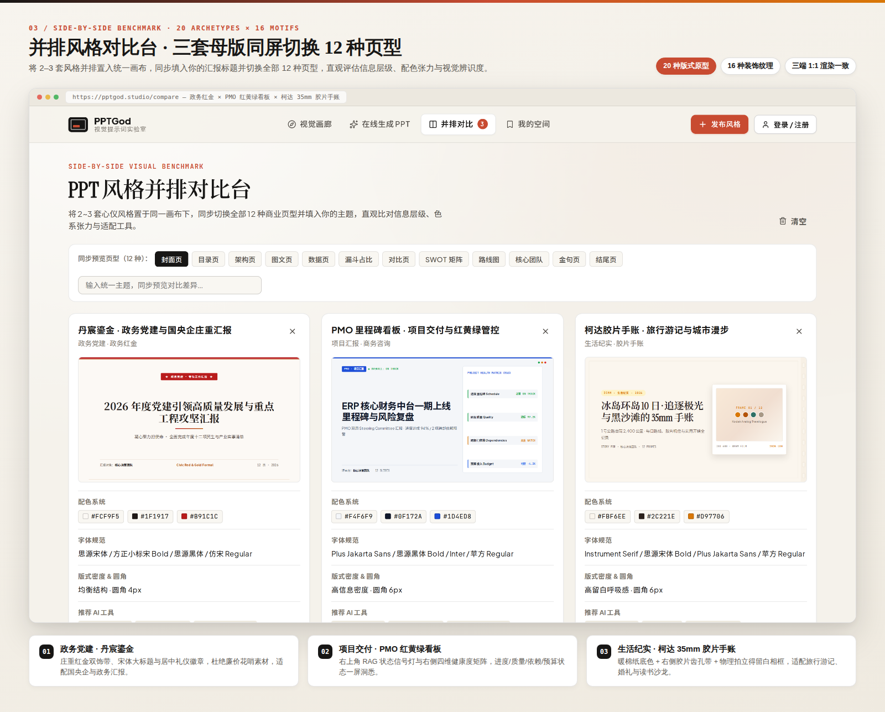
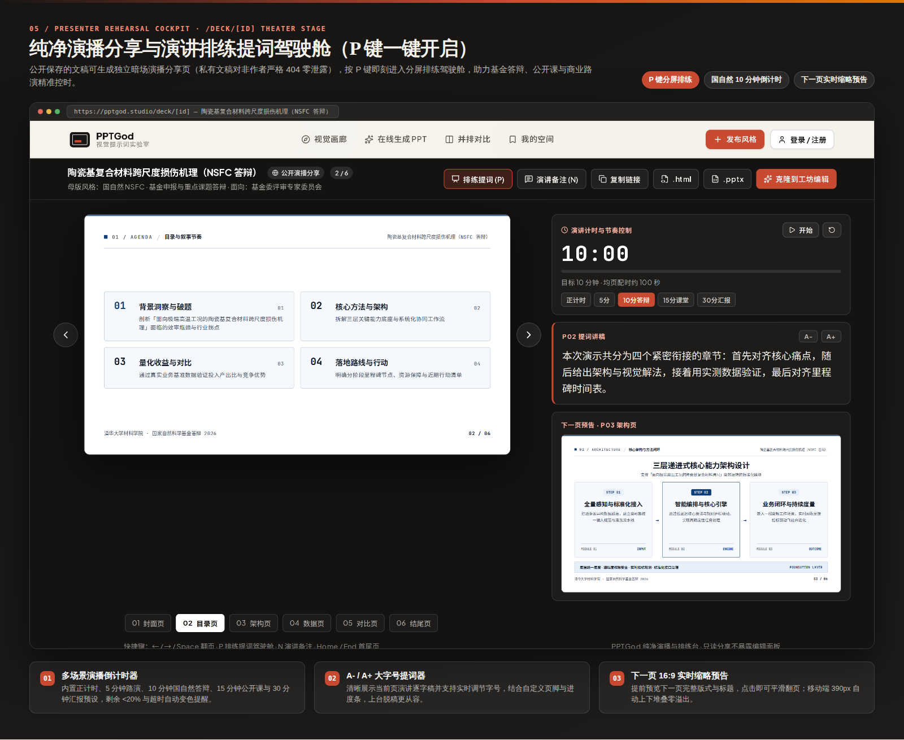
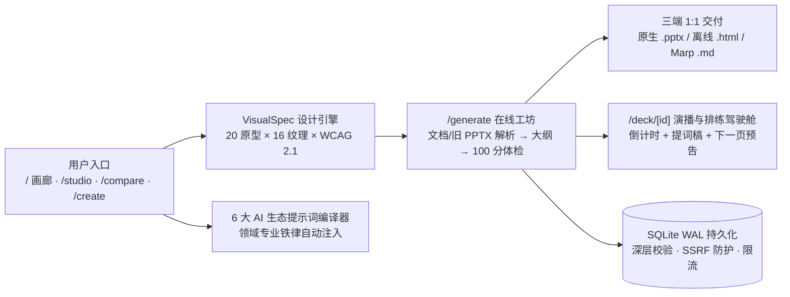

<div align="center">

# PPTGod v6

**先看见 16:9 真实视觉效果，再带走精准提示词与原生可编辑 PPT**

全领域可视化 PPT 提示词画廊 · 6 大 AI 生态领域编译器 · 100 分智能设计体检 · 演讲排练提词驾驶舱


<br />


</div>

---

## 产品定位与核心价值

**PPTGod** 是一个基于 **Next.js 16 (App Router) + React 19 + TypeScript + 100% 纯 Vanilla CSS + SQLite (`better-sqlite3`, WAL) + `pptxgenjs` + `mammoth` + `unpdf`** 构建的全栈开源平台，采用**「可视化选词 + 跨生态领域提示词编译」**与**「结构化高保真在线生成 + 演讲排练」**双核架构：

- **所见即所得，告别“盲猜提示词”**：内置 **36 套全领域精选设计系统 × 20 种版式原型 × 16 种装饰纹理 × 12 种页型**，覆盖商业科技、教师课堂、科研基金、项目政务与生活纪实全场景，所有卡片均以真实 **16:9 幻灯片画布**实时渲染。
- **跨工具零损耗交付**：既可一键编译适配 **Claude HTML / Gamma / Kimi / NotebookLM / 即梦生图（单页、6 页、12 页词包）/ Slidev / Python-PPTX**，也可直接在站内上传文档或旧 `.pptx` 一键翻新，经 **100 分制智能设计体检**后直出原生可编辑 **`.pptx`**、离线矢量打印 **`.html` / PDF**、可运行 **Marp `.md`** 与可移植 **`.pptgod.json`** 风格包。
- **零外部付费依赖、开箱即用**：内置纯前端 Canvas 以图生风格引擎、WCAG 2.1 对比度守卫、确定性智能生成与体检引擎以及本地 SQLite WAL 持久化，支持 `npm run dev` 与 `docker compose up` 一键部署。

---

## 网站核心功能演示效果图

### 1. 首页视觉画廊 · 36 套全领域设计系统与 5 大人群导航

支持全局输入主题实时刷新全部 36 张 16:9 风格画布、按 5 大人群领域与 15 类场景筛选、首页卡片直切全部 12 种页型，以及 6 目标「30 秒智能选词顾问」。

<p align="center">
  
</p>

### 2. 交互式提示词工作室 · 领域专属母版与 6 大 AI 生态编译

面向教师授课与科研基金等高专业度场景，提供护眼黑板粉笔板书、*Nature Methods* Okabe-Ito 色盲安全科研证据流、国自然 NSFC 蓝红答辩等真实规范母版；编译器自动按领域注入教学闭环铁律、科研零幻觉红线（缺失数据强制占位 `[待补实验数据]`）、PMO 管控与 STAR 述职规范，并支持 5 维视觉透视、动态 `1200×630` OG 社交预览卡与 `.pptgod.json` 导出。

<p align="center">
  
</p>

### 3. 并排风格对比台 · 20 种原生版式 × 16 种纹理三端 1:1 渲染

将 2–3 套心仪风格置于同一画布下，同步切换全部 12 种页型并注入你的真实汇报题目；所有 20 种版式原型与 15 种非空装饰纹理在浏览器画布、原生 `.pptx` 与离线 `.html` 三端保持 1:1 视觉一致。

<p align="center">
  
</p>

### 4. 在线生成工坊（100 分智能体检 + 自定义机构页脚）& 以图生风格

- **在线工坊（`/generate`）**：支持上传 `.pdf` / `.docx` / 存量 `.pptx` 逆向翻新 / `.md` / `.txt`（最大 10MB），提供 7 套全领域实景预设、5 领域 `<optgroup>` 分组换肤、两步可控大纲（5–20 页）、自定义机构/课程/实验室页脚署名（三端同步）及 **100 分制智能体检**（投影对比度、字数防溢出、版式节奏、一键补齐讲稿）。
- **以图生风格（`/create`）**：上传任意心仪海报或 PPT 截图，纯浏览器端 Canvas 毫秒级量化提取 8 色 + 4 阶图表色板并自动达标 WCAG 2.1 AA/AAA 可读性，零隐私上传。

<p align="center">
  
</p>

### 5. 纯净演播分享页与演讲排练提词驾驶舱（`/deck/[id]`）

公开保存的文稿可一键生成暗场 16:9 演播分享链接（私有文稿对非作者严格返回 `404` 零泄露）；按 **`P` 键**即刻进入分屏演讲排练驾驶舱，内置正计时与 **5 分钟路演 / 10 分钟国自然答辩 / 15 分钟公开课 / 30 分钟汇报** 倒计时（剩余 < 20% 琥珀预警、超时红灯）、`A-/A+` 大字号提词稿与下一页 16:9 实时缩略预告。

<p align="center">
  
</p>

---

## 36 套全领域精选风格覆盖矩阵

| 人群领域 | 覆盖场景 | 代表风格与专属设计规范 |
| --- | --- | --- |
| **商业与科技**（11 套） | 产品发布、商业路演、品牌提案、技术分享 | 苹果柔光 Bento、暗夜星环 Keynote、瑞士网格、工业控制论橙黑、北欧静奢、巴黎高定画册、包豪斯几何 |
| **教师与课堂**（5 套） | 课堂教学、教育培训 | 墨绿护眼黑板粉笔板书（`chalkboard-class`）、K12 马卡龙绘本、STEAM 工程方格探究本、公开课青瓷说课、结构化企业内训 |
| **科研与学术**（6 套） | 科研基金、学术答辩 | 国自然 NSFC 蓝红基金答辩、*Nature Methods* Okabe-Ito 色盲安全科研（`scientific-figure`）、顶会组会精读、人文社科档案、临床医药、LaTeX 顶刊 |
| **项目与职场**（9 套） | 项目汇报、咨询汇报、政务党建、个人述职、年度总结 | PMO 红黄绿里程碑看板（`pmo-rag-grid`）、丹宸鎏金政务红金（`civic-redgold`）、Linear 敏捷 OKR、麦肯锡高管洞察、华尔街金融终端、STAR 晋升述职、ESG 绿色精益 |
| **生活与个人**（7 套） | 生活纪实、文化创意、个人述职 | 柯达 35mm 胶片手账游记（`polaroid-zine`）、香槟鼠尾草婚礼纪念、独立书店读书沙龙、牛油果极简生活、宋韵新中式、莫兰迪作品集 |

---

## 系统架构与安全防线



- **深层 `VisualSpec` 强校验**：严格校验所有 CSS 色值、4 色图表元组、20 原型 / 16 纹理枚举、圆角 `[0, 32]` 与 `brandFooter` 纯文本防 XSS。
- **BYOK SSRF 与权限隔离**：拦截云元数据地址、RFC1918/IPv6 内网段与混淆 IP；登录/注册 `429` 限流；私有风格与私有文稿在 SSR、API、OG 图像与 `/sitemap.xml` 全链路严格零泄露。

---

## 本地运行、Docker 部署与全栈测试

### 1. 本地开发运行

```bash
npm install
npm run dev
```

首次启动自动在 `./data/pptgod.db`（WAL 模式）初始化数据库并幂等写入 **36 套全领域精选风格**、3 个种子账号（内置体验账号：`demo@pptgod.studio` / `demo1234`）与 5 条初始实测评价。

### 2. Docker Compose 一键自托管部署

```bash
docker compose up -d --build

# 验证生产探活端点
curl http://localhost:3000/api/health
```

### 3. 生产构建与 99 条全栈黑盒端到端测试

```bash
# 静态类型、React 19 严格 ESLint 与生产构建
npx tsc --noEmit --incremental false
npm run lint
npm run build
npx next start --port 3000

# 运行覆盖 Tiers 1–8 的 99 条全栈端到端黑盒测试（含 SQLite WAL 数据卫生审计）
PLAYWRIGHT_BROWSERS_PATH=/opt/ms-playwright python3 tests/e2e/run_e2e.py \
  --base-url http://localhost:3000 --tier all --backup-db
```